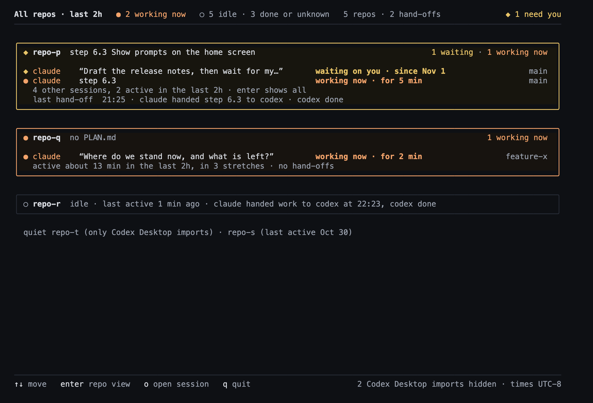

# multi-link

[](https://github.com/jar-narvz/multi-link/actions/workflows/ci.yml)

See every Claude Code and Codex session on your Mac in one place: which ones need you, and which Claude session
handed work to which Codex run.

## Why

If you run several Claude Code and Codex sessions across a few repos, you lose track fast. Which session is waiting
on you? Which Claude session started that Codex run, and did it finish? Where is each repo in its plan? Each tool only
shows its own sessions, one window at a time. multi-link reads them all and puts them on one screen.

A **hand-off** is when a Claude session starts a Codex run, for example by running `codex exec "…"`: Claude plans
and reviews, Codex implements.



*The home screen, rendered from synthetic test data (`fixtures/sessions-phase6`). Real renders are not committed
because they show your prompts.*

## What it does

- **Menu-bar app.** The `ml` icon shows how many Claude sessions are waiting on you (Codex sessions are not counted:
  see Limitations). Click it to see every repo's sessions. It sends a notification when a handed-off Codex run
  finishes its turn.
- **Terminal dashboard** (`multi-link tui`) with four views: [home](docs/reference.md#home-screen) (repos sorted by
  who needs you), a [repo timeline](docs/reference.md#repo-view), a [step graph](docs/reference.md#step-graph) (one
  PLAN.md step's planning, implementing and review, in order) and a [live grid](docs/reference.md#live-grid) (what
  every active agent is doing now).
- **Claude → Codex links.** Each Codex run sits under the Claude session that started it. A link is marked
  `confirmed` when Codex's session id was seen, and `matched by time` when it is a guess.
- **Open or jump.** Open a session in the Claude desktop app (if you use it), resume a finished one, or bring a
  running terminal session's tab to the front.
- **Plan steps.** If a repo has a `PLAN.md` / `PROGRESS.md` and your hand-off prompts name a step (`Step 6.7`),
  sessions are grouped by step. Without them everything else still works; the step graph just has nothing to show.
- **JSON CLI.** Every view is also a command with `--json` output, for scripts.

## Install

Needs an Apple silicon Mac (arm64) with macOS 15 or later. No Rust or Xcode needed.

### Homebrew (recommended)

1. Trust multi-link's tap (Homebrew refuses casks from a tap you have not trusted):

   ```bash
   brew trust --cask jar-narvz/tap/multi-link
   ```

2. Install it:

   ```bash
   brew install --cask jar-narvz/tap/multi-link
   ```

   This puts the app in `/Applications` and the `multi-link` command on your `PATH`.

3. Open multi-link from Applications. macOS blocks it the first time, because the app is not notarized. Click
   **Done**, then go to System Settings → Privacy & Security, click **Open Anyway** next to "multi-link was
   blocked…", and enter your password. You do this once.
4. In the setup window, click **Turn on everything**. This adds multi-link's Claude Code hooks to
   `~/.claude/settings.json` (after saving a backup beside it) and turns on Open at login. The
   hooks let multi-link record hand-offs as they happen. It also asks macOS to allow notifications: the rows turn
   green once each part is on, and if notifications are off, **Open Settings** goes straight there. If your hooks
   already call another copy of multi-link (such as a source build), the row says "Hooks use another copy" and the
   click moves them to this app.
5. Start a new Claude session, so it loads the hooks.

### Or download the DMG

1. Download `multi-link-<version>-arm64.dmg` from the [releases page](https://github.com/jar-narvz/multi-link/releases).
2. Open it and drag **multi-link** onto **Applications**.
3. Open it from Applications and click **Open Anyway** once, as in step 3 above.
4. Click **Turn on everything**, then start a new Claude session.

A DMG install does not put `multi-link` on your `PATH`; the setup window's **Use in Terminal** line gives you a
one-line command that does.

### Check it works

```bash
multi-link setup < /dev/null
```

`setup` checks the CLI, the hooks and the app. With input closed (`< /dev/null`) it cannot ask you anything, so it
only reports and changes nothing. You should see three lines: `cli: ok (…)`, `hooks: ok (…)` and `app: installed (/Applications/multi-link.app)`, and
the `ml` icon in your menu bar. (DMG install without the **Use in Terminal** command: run
`/Applications/multi-link.app/Contents/MacOS/multi-link setup < /dev/null` instead.) If `ml` is missing on a MacBook with a notch, the menu bar may be full: ⌘-drag another
icon away.

Upgrading, uninstalling, the Terminal link for DMG installs, switching from the DMG to Homebrew, building from source
and the hook details are in [docs/install.md](docs/install.md).

## Using it

**Menu bar.** Click `ml` to see one block per repo, headed by its current plan step, with each session and its Codex
hand-offs. Click a session row to open it or jump to its terminal tab; click a Codex row to copy its id.
`Open TUI` opens the terminal dashboard, and `Setup…` reopens the setup window.

**Terminal dashboard.** Run `multi-link tui` (or `multi-link tui --live` to start on the live grid).

| Key | What it does |
|---|---|
| `↑` `↓` | Move the selection (`←` `→` in the step graph and along a live-grid row) |
| `Enter` | Open a repo's timeline (also `t` on home) |
| `s` | Open the step graph (from a timeline lane or a live-grid card) |
| `l` | Open the live grid (from home or a timeline) |
| `o` / `f` | Open (or jump to) the selected session / fork it into a new session |
| `Esc` / `q` | Go back / quit |

It shows the last 2 hours by default; add `--since all` for all history. All keys are in
[docs/reference.md](docs/reference.md#run).

**JSON commands.**

```sh
multi-link overview --json
multi-link sessions --json
multi-link links --json
multi-link live --json
multi-link graph --repo "$PWD" --step <step-id> --json
multi-link open <session-id-prefix> --dry-run
```

## How it works

- It reads the transcript files Claude Code and Codex already write on your Mac (`~/.claude`, `~/.codex`), plus each
  repo's git metadata and plan files.
- An optional Claude Code hook records hand-offs as they happen, so more links are `confirmed`.
- Nothing leaves your machine: multi-link itself makes no network calls (only Homebrew or your browser download it).
- Built with Rust (the CLI and the terminal dashboard, `crates/`) and SwiftUI (the menu-bar app, `apps/menubar/`).
  The app runs the CLI bundled inside it.
- Neither tool documents its transcript format, so every rule is a reading of real files, built to fall back to
  `unknown` when a marker is missing. Details: [States and links](docs/reference.md#states-and-links-release-16).

## Limitations

- **macOS on Apple silicon only** (macOS 15 or later).
- **Not notarized** (no Apple Developer account), so macOS needs **Open Anyway** once after a fresh install. A managed
  Mac may not allow that.
- **Undocumented transcript formats.** A Claude Code or Codex update can break a rule; unknown records are skipped and
  counted, and states or links may become `unknown`.
- **Links matched by time can be wrong.** Only `confirmed` links are certain.
- **Codex "waiting on you" is not detected**, and Codex "done" only means its last turn completed.
- **The terminal jump works in Terminal.app**; iTerm2 is untested, and tmux and other terminals are not supported.
- **A real `brew upgrade` has not been seen yet.** It should keep the Open Anyway approval; the owner's check of
  Release 1.20 ([docs/phase24-check.md](docs/phase24-check.md)) is the first real one.
- **JSON output includes prompt text** (prompts of up to 120 characters each, and the graph's last messages). Check
  before you share it.

The full list, with the evidence and numbers behind each item, is in
[docs/reference.md](docs/reference.md#limitations-and-validation).

## More

- [Install guide](docs/install.md): every install path, uninstall, hook setup
- [Reference](docs/reference.md): each screen in detail, states and links, all keys, full limitations, release history,
  [releasing](docs/reference.md#releasing)
- [Design](docs/design.md) and [output schema](docs/output-schema.md)
- [Plan](PLAN.md) and [progress log](PROGRESS.md): how this was built, step by step
