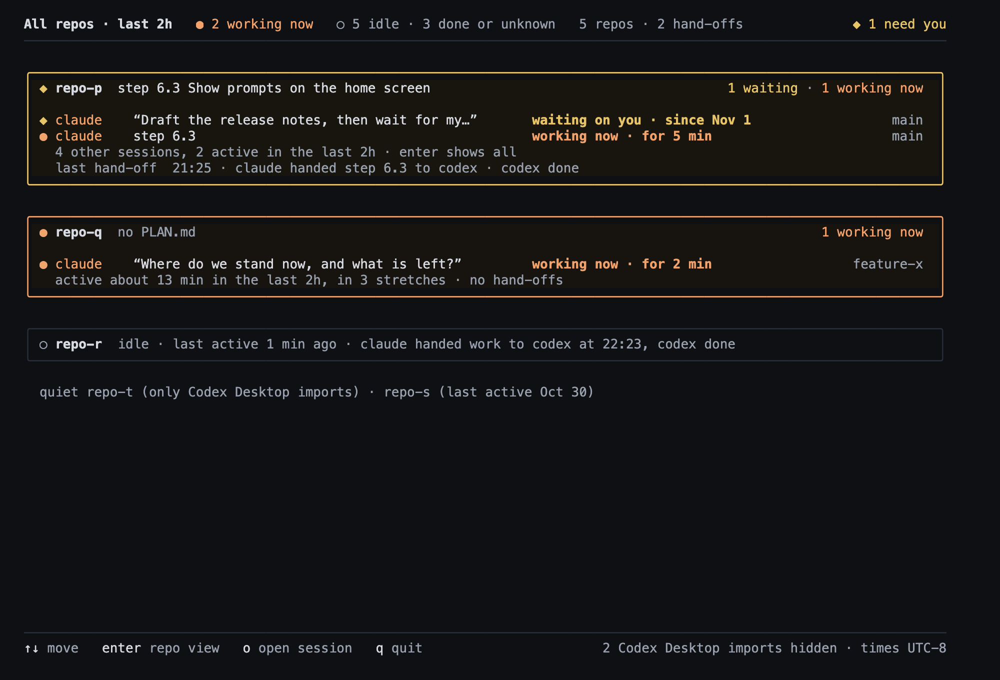
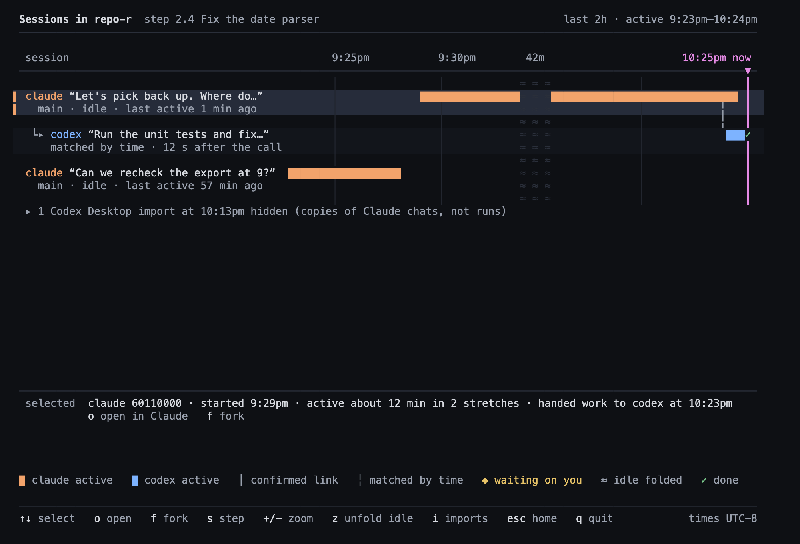
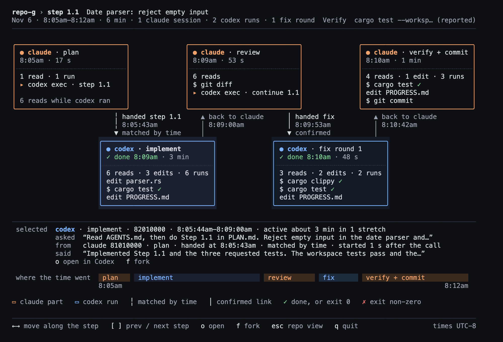
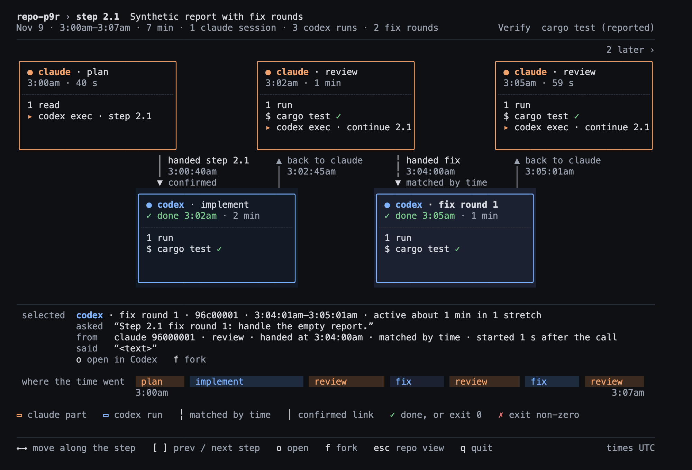
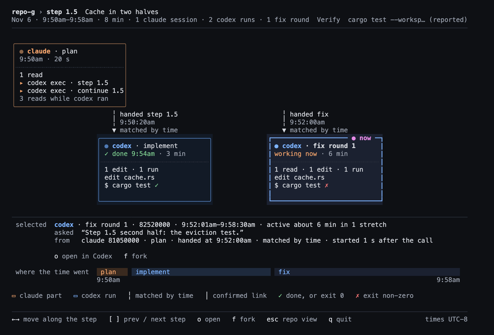

# multi-link

A local terminal dashboard for Claude Code and Codex sessions across your repos.
Release 1 is complete (see [check results](docs/phase3-check.md)). Release 1.1 (home screen
cleanup) did not meet the need ([owner verdict](docs/phase4-check.md#owner-check-stop-and-ask)), and
neither did Release 1.2's bars ([owner verdict](docs/phase5-check.md#owner-check-stop-and-ask--answered-2026-11-01)).
Release 1.3 rebuilt home in plain words and the repo view as swimlanes, to two approved mockups; the
owner approved the real screen ([visual check](docs/phase6-check.md)). Release 1.4 polishes those screens
on real data (prompts after a system reminder, window words, clock times, axis labels); the owner approved it
([real check](docs/phase7-check.md)). Release 1.5 adds the step graph: one PLAN.md step's Claude and Codex parts
along time; the owner approved it ([real check](docs/phase8-check.md)). Release 1.6 makes states and links truthful:
ended Claude sessions say `finished`, compressed Codex rollouts are read, and more hand-offs find their run; the owner
confirmed it on real data ([real check](docs/phase9-check.md)). Release 1.7 replaces hand-merging hook JSON with
`multi-link hook check`, which reports your hooks and prints one command that updates them ([hook setup](#hook-setup)).

- Groups sessions by repo, with needs-you sorting, states and PLAN.md / PROGRESS.md status.
- Links Claude hand-offs to Codex sessions, marking exact, heuristic and ambiguous matches.
- Shows when each session was active in a per-repo swimlane view, with Codex runs nested under the
  Claude session that started them.
- Opens supported Claude desktop sessions or resumes sessions confirmed finished; rechecks the
  action before executing. Unsupported actions show a command for you to run.
- Draws one PLAN.md step as boxes along time: who planned, implemented, reviewed and fixed, in order.

## Home screen



Times use a 12-hour clock with lowercase `am`/`pm`, no leading zero or space (`9:05pm`, with seconds
`8:05:43am`).

*HTML render of the home buffer on the synthetic fixture `fixtures/sessions-phase6` at 120×40
(`crates/tui/examples/home_html.rs`; method, the approved mockup in words and real-data differences in
[docs/phase6-check.md](docs/phase6-check.md)). Real renders are not committed because they show prompts.
The real terminal uses your own font.*

- **Top line:** working, stale, idle and done-or-unknown counts, repos and hand-offs, and on the right
  `◆ N need you` in yellow when a session is waiting. With nothing waiting and no hook records seen, it
  says `◆ needs-you partial: no hook records seen` instead of claiming zero.
- **A card for each repo with a waiting, working or stale session:** a rounded
  card (yellow when waiting, orange when working) titled with its latest PLAN.md step. Each such session is
  one line: harness, a label (its custom title, else its latest step, else its latest prompt in quotes, falling back to its first prompt, else `claude · no prompt`), a status
  phrase (`waiting on you · since 9:40pm`, `working now · for 5 min`, `stale since …`) and its place (`worktree <folder>` or the current main branch).
  App background preambles are skipped separately for each prompt candidate. A repo header adds
  `· latest hand-off step <id>` when the hand-off differs from the logged step.
  **Claude prompt:** the first user message that is not blank and does not start with `<`, after dropping
  any leading `<system-reminder>…</system-reminder>` blocks (what a session started by another session
  begins with), so the real text after them counts; an unclosed reminder or any other leading tag still
  skips the message. Codex uses its first user message (or, in `codex exec` rollouts, the first user input
  that is not AGENTS.md instructions or a tag). **Times** less than 24 h old are a clock time (`9:05pm`,
  even if that was yesterday: 11:53pm seen at 2:07pm the next day); older ones are a date (`Nov 1`); `last active` says `N min ago` within the
  hour. A grey line counts the other sessions, and the last line names the latest hand-off in words (`claude handed
  step 6.3 to codex · codex done`).
- **The window is named:** the header and the card's lines say `last 2h`, or the `--since` window
  (`last 16h`).
- **Idle repos are one sentence:** `idle · last active 1 min ago · claude handed work to codex at 10:23pm,
  codex done`. Repos with no activity in the window share one `quiet` line.
- **Codex Desktop imports are hidden** (they are Claude chats copied into Codex Desktop, not runs); the
  footer counts them.
- **Colour** uses truecolor when `COLORTERM` is `truecolor`/`24bit`, else 256 colours; `NO_COLOR` keeps
  every glyph and word. Below 80 columns the branch drops first, then labels shorten on a word boundary.

## Repo view



*Same fixture, repo `repo-r`, its newest lane selected.*

- **Enter** (or `t`) on a home repo opens it. One lane per session with activity in the window, newest
  first; each Codex run sits under the Claude session that handed it work (`└▸`).
- **Bars are recorded activity:** timestamps at most 5 minutes apart form one burst. Claude bursts are
  orange, Codex blue; `✓` marks a finished Codex run, `◆` a session waiting on you.
- **Now line:** a magenta `┃` runs down the lanes at the current time, with `▼` and the `now` label on the axis.
  Bars, `✓` and `◆` draw over it, so a session that is working now visibly reaches it; grid and link lines give
  way to it. Magenta means now and nothing else, in both views. Panned into the past, the line is not drawn.
- **Links:** a line from the hand-off point to the child, solid `│` when confirmed, dashed `╎` when matched
  by time, and the sub line says how (`matched by time · 12 s after the call`).
- **The axis fits the work:** it starts at the first activity; idle stretches over 15 minutes with no
  activity on any lane fold to a `≈` band (at most 3), labelled with its length when there is room
  among the fold labels. The `now` label is placed first (`10:25pm now`, or `now` when space is short), so a fold
  never hides it; fold lengths then win over the end clock and ticks, and a tick never repeats the end or `now`
  minute. `z` unfolds,
  `+`/`-` zoom, ←/→ pan, `0` returns to the fitted range, `i` shows hidden imports.
- The `selected` line gives the session's short id, start, how long it was active and its hand-off; `o`
  opens it and `f` forks it. Below 80 columns the bars drop and the lanes become a list.

## Step graph



*HTML render of the step graph on the synthetic fixture `fixtures/sessions-phase8`, step 1.1, at 120×40 (method,
the approved board 9 in words and real-data differences in [docs/phase8-check.md](docs/phase8-check.md)).*



*Synthetic fixture `fixtures/sessions-phase9`, step 2.1: one Codex run resumed twice with `codex exec resume --last`
shows as implement, fix round 1 and fix round 2, with a Claude review between them
([docs/phase9-check.md](docs/phase9-check.md)).*



*Synthetic fixture, step 1.5, while its fix round is still running ([docs/phase11-check.md](docs/phase11-check.md)).*

- **Live parts:** the part working now gets a heavy border in its colour and a magenta `● now` badge; while
  something is live, finished parts' borders and dots recede (their text keeps its colour). A Codex part is live
  while its run is `working` and it is that run's newest window; a Claude part is live when it is its session's
  newest part, the session is working and it was active in the last 5 minutes. A live part scrolled off screen
  shows `● now · N later ›` (or `‹ N earlier · ● now`); below 120 columns the list marks it `● now`.

- **`s`** on a repo-view lane opens that lane's latest tagged step. A coordinator lane with no hand-off of its own
  lists the steps of the sessions it started; a lane with neither says `no step on this session`. `←→` moves along
  the parts (`↑↓` below 120 columns), `[ ]` goes to the previous or next step with tagged hand-offs, `o`/`f` open or
  fork the selected part's session, `esc` returns to the repo view. The same report is on the CLI:
  `multi-link graph --repo "$PWD" --step 6.7 [--json]`.
- **Which sessions belong to a step:** only hand-offs whose prompt names the step (`Step 6.7`), their Claude parents
  and their Codex children. Steps are never guessed from time or files, so a step whose hand-off prompt did not name
  it, or a Claude-only step, has no graph.
- **Parts:** Claude boxes on top, Codex runs below, cut at hand-offs (the only events both harnesses record). Each box
  shows its start and length, `N reads · N edits · N runs`, and up to 3 notable calls with fixed labels (`$ cargo
  test`, `$ git commit`, `edit <file>` …). Edges say how each run was linked; the panel shows the selected part's
  prompt, its hand-off and the run's last message; the bottom strip shows each part's share of the step's time.
- **Part names are a reading by position, not evidence** (G3): the first Codex run is `implement`, every later run in
  the chain is `fix round N`, a Claude part followed by another hand-off is `review`, and the last is `verify +
  commit` only if it holds a `git commit`. A later run is not always a fix: Step 8.4's graph names every Codex run
  after the first `fix round 1` … `fix round 24`, though they come from 28 calls of 7 test halves, 7 code halves
  and 14 review fix calls (the first went through a wrapper script, are untagged and are not drawn).
- **Counts and marks** (G5, G6): shell commands that write files count as runs, not edits, because telling a write from
  shell text would be a guess, so boxes show fewer edits than happened. Labels are fixed by category, and no other
  command text is shown. `✓`/`✗` mean the call exited 0 / non-zero, not "tests passed" (a pipe to `grep` hides a
  failure). `✓` is drawn only on `$ cargo …`, `$ pytest` and `$ npm test`; any call that exited non-zero gets `✗`; a
  cargo, pytest or npm line with no mark has no recorded exit code. The header's Verify is the PLAN.md command, marked
  `(reported)`, never passed or failed.
- **Missing Codex runs:** an unlinked hand-off shows a dim `no codex run found` box, no return arrow, and `(the
  rollout may be gone)` in the panel. That wording is still wrong for some: Phase 9's rules (compressed rollouts,
  redirect logs, `resume --last`, below) cut real unlinked hand-offs from 124 of 222 to 47 of 221 on 2026-11-08, but
  at least 3 of the 47 (`cd` then `resume --last`) have their run on disk ([counts](docs/phase9-check.md#links)).
  While a run is unlinked, the Claude part around it usually covers the time Codex worked, unless an earlier Codex run
  is still open (step 6.6).

## States and links (Release 1.6)

Each rule below reads a format that Claude Code or Codex does not document; only the `SessionEnd` hook event is
documented. Each is designed so that a missing marker falls back to `unknown` or unlinked; a format that changes in
another way (say, `cost-state` written mid-session) could still give wrong results. Real counts before and after are
in [docs/phase9-check.md](docs/phase9-check.md).

- **`finished` and its evidence.** A Claude session is `finished` only on positive evidence, checked in this order:
  its live session record (`~/.claude/sessions/<pid>.json`) means it is running and wins; `process_exit` (the record
  outlived its process); `session_end` (the hook's `SessionEnd` record, dropped when a later turn or hook record shows
  the session was resumed); `transcript_exit` (no live record, and the transcript's last `cost-state` record comes
  after its last turn; Claude Code writes it on every clean exit seen so far). This moved real Claude sessions from
  232 `unknown` / 0 `finished` to 3 / 229 (2026-11-08). Codex `done` still means only that the last turn completed.
- **Reopening a session finished by `transcript_exit` or `session_end`** depends on where it ran (the transcript's
  last `entrypoint`): `cli` or `sdk-cli` → `claude --resume <id>` in its folder; `claude-desktop` → the app link, only
  when exactly one desktop app record maps the session; anything else → Unavailable with the command shown, so a
  cleanly exited desktop session is not resumed in a terminal while the app may reopen it. A `process_exit` session
  still resumes in a terminal whatever its entrypoint (0 real cases on 2026-11-08).
- **Compressed rollouts.** Older Codex rollouts are on disk as `rollout-*.jsonl.zst` (a standard zstd frame holding
  the same JSONL). multi-link decompresses them in pure Rust (`ruzstd`), up to 64 MiB each; a file over the cap or
  that fails to decode is counted as unreadable, never an error. When the same run exists in both forms, the plain
  file wins. On 2026-11-08 this added 202 Codex sessions (223 → 425).
- **Redirect rule.** When a `codex exec` hand-off sends stdout to a file (`> log 2>&1`, `>>`, `1>`, `&>`, `&>>`,
  `>|`), the hook and the scanner read that file for Codex's `session id:` line. The link is `exact` (`redirect_file`)
  only when the file holds exactly one such line. Path limits: the target must be a literal path (no `$VAR` or quoted
  expansion), the segment must have exactly one stdout redirect, and a relative path counts only when no `cd` or
  subshell comes before the launch. The opened file must be a regular file (not a FIFO or device), have a single link
  and resolve under the hand-off's folder or the system temp folder (`$TMPDIR`, `/tmp`, `/private/tmp`). At most 64
  KiB is read, and an append log (`>>`, `&>>`) over 64 KiB is refused. Pipes to `tail` or `head` are not recoverable.
  Old logs are mostly gone, so the gain grows as the hook records new hand-offs.
- **`resume --last` linking.** `codex exec resume --last` names no session id. As seen so far (undocumented), it
  writes no new rollout and adds a turn to the run it resumes. multi-link links it to a run in the same checkout whose
  later turn (not its first) starts 0–10 s after the hand-off: `heuristic` with evidence `resume_turn`, or ambiguous
  when two runs qualify. An observed id (stdout or a redirect log) still wins and makes it exact. The 10 s window was
  not calibrated in advance; on real data all 13 such hand-offs had their turn 0.8–2.7 s later. A `cd` before the
  launch keeps the hand-off unlinked (3 real cases), as it does for the creation-time match.
- **Session folder (R8).** The first folder a Claude session's own records name is its home folder (records inherited
  from a resumed session do not set it). After that, a record's folder counts only if it is the home folder or inside
  it, so a shell `cd` elsewhere (Claude Code stamps later records with it) is ignored and the session stays in its
  repo; the session shows the newest folder that counts, such as a worktree.

Scanning only reads local agent files (`~/.claude`, `~/.codex`), repo metadata and optional
hook state in `~/.multi-link`. It makes no network calls. Opening a session launches the
corresponding external program; hook recording writes multi-link's own state directory.

## Install

Requires macOS, Rust/Cargo and git. From the repo:

```sh
cargo install --path crates/cli --locked
multi-link tui
```

This puts the binary at `~/.cargo/bin/multi-link`. To try it without installing, use
`cargo build --release -p multi-link` and run `target/release/multi-link` instead.

### Hook setup

The screens work without hooks. The Claude Code hook adds exact links for hand-offs whose Codex id only reaches the
hook, step tags as they happen, "waiting on you" when the app has no session record, and `session_end` when a
session exits. multi-link never edits your Claude settings; it checks them and prints a command you run.

```sh
multi-link hook check
```

It reads one settings file: `~/.claude/settings.json` (or `$CLAUDE_CONFIG_DIR/settings.json` when that is set),
`--scope local` for the repo's `.claude/settings.local.json`, or `--settings <path>`. It prints the file it read,
one line per hook event and, when something can be fixed, one command:

- `ok`: exactly one multi-link entry, equal to what this binary would generate. All `ok` → `multi-link hooks in
  <file> are current`, exit 0.
- `missing`, `outdated` (another binary path, `async` or `timeout`; both paths are shown) or `duplicate`: fixed by the
  printed command. Exit 1.
- `customized` (a multi-link entry you changed, such as an `if` key or a narrower matcher), `unknown event`, or
  `disableAllHooks: true`: reported for you to edit by hand, never changed. Exit 1.
- A file it cannot safely read or merge (invalid JSON, wrong types, a directory, a dangling symlink, values that would
  not survive a rewrite, below): the reason, no command, exit 2.

Copy the printed command and run it. It is plain `sh`: it copies an existing file to a backup beside it
(`settings.json.multi-link-backup-<UTC time>-XXXXXX`; an absent file is created instead), writes `multi-link hook check --merged` to a private temp file
in the same folder, gives it the file's mode and moves it into place in one step, so the file is never half-written;
if any part fails it removes the temp file and the original stays as it was. Only multi-link's own entries for
`missing`, `outdated` and `duplicate` events change; your other hooks, keys and their order stay. Run
`multi-link hook check` again to see exit 0, then start a new Claude session so it loads the hooks.

Run the check with the binary you want the hooks to call (normally the installed one): the hooks are compared with
that binary's path. `hook install` still prints the bare snippet, and `hook uninstall` prints what to remove.

## Run

Use ↑/↓ to select, Enter (or `t`) to open a repo view, `o` to open, `f` to fork, Esc to return, and
`q` to quit. In the repo view, `+`/`-` zoom, ←/→ pan, `0` resets the range, `z` unfolds idle stretches
and `i` shows imports; `s` opens the step graph for the selected lane. The default history window is `2h`; use
`--since all` for all history.

The CLI also exposes the data and safe open previews:

```sh
multi-link overview --json
multi-link sessions --json
multi-link links --json
multi-link steps --repo "$PWD" --json
multi-link graph --repo "$PWD" --step 6.7 --json
multi-link open <session-id-prefix> --dry-run
```

For fixture data, add `--root fixtures/sessions --now 2026-10-29T23:15:00Z --since all`
to `tui` or the report commands. `--root` enables fixture mode and disables real process probing.
Hooks are set up with `hook check` ([above](#hook-setup)). See the [design](docs/design.md) for hook behavior and
state rules.

## Limitations and validation

- Claude Code and Codex transcript formats are undocumented and may change. Unknown records
  are skipped and counted; missing evidence can leave states or links unknown.
- Codex waiting detection and automatic Codex opening are unsupported.
- Claude desktop opening uses an undocumented `claude://` link.
- Resume and the app link require a transcript and positive exit evidence (above). `transcript_exit`
  relies on the undocumented `cost-state` record; `session_end` needs the hook with `SessionEnd` (`multi-link hook check`
  reports it). On 2026-11-08, 72 finished desktop sessions had no single app record, so
  `o` shows Unavailable with the command for them.
- Ambiguous links rose from 1 to 9 once compressed rollouts were read: on 2026-10-30 several Codex runs started
  in one checkout within the 60 s creation window. In each case one run started 0.5–1.8 s after the hand-off and
  another 3.0–58.7 s after it. multi-link does not pick the nearest run, so these stay ambiguous
  ([details](docs/phase9-check.md#why-ambiguous-links-rose-from-1-to-9)).
- A keypress arriving together with a terminal resize can be delayed until the next key
  (crossterm 0.29).
- Activity is inferred from record timestamps: a tool call that writes nothing for over 5 minutes
  shows as a gap, and screens say "active", never "worked".
- Codex "done" means its last turn completed; there is no process-exit evidence.
- Some sessions still show `no prompt`. On 2026-11-02 (PST): 11 of 185 Claude sessions (in the Phase 7
  plan's count these were other wrappers such as `local-command-caveat`, `bash-input`, `scheduled-task`, a
  reminder with nothing after it, or no eligible record) and 3 older non-imported Codex runs
  ([counts](docs/phase7-check.md#real-prompt-count-p1)).
- JSON output now includes prompt text: `sessions` and `overview` carry each session's first prompt
  (`asked`, up to 120 characters). Check before sharing JSON.
- macOS only for now.
- Hook setup limits. The merged file is rewritten as 2-space JSON, so its whitespace and indentation may change
  (values, key order and your entries do not). To keep values exact, the check refuses (exit 2) a file with a
  duplicate key or with a number serde_json would not write back as the same text: beyond 64-bit integers, and also
  forms like `1e5` or `1.50`. An edit to the settings file in the milliseconds between `--merged` reading it and the
  final `mv` is lost; there is no lock that Claude Code also honours. "Current" means current in that one file: it
  does not read other settings levels (project, local, managed policy), so it cannot prove they let the hooks run.
  The binary path is compared as text, not checked to exist.
- Step graph limits: Step 8.4's own graph is misnamed (24 runs as fix rounds) and 10 of its 25 runs are unlinked.
  Nesting sessions under the session that started them (repo view, and `s` on a coordinator lane) relies on the
  Claude desktop app's undocumented per-session records. The first refresh after start takes about 6.4 s on the
  owner's machine (the overview's first full parse, older than the graph); later refreshes with the largest real
  graph open took 229–236 ms (Step 8.5). Pressing `[ ]` quickly builds every graph it passes (about 230 ms each). The repo view's footer
  drops `q quit` at 101–109 columns. With a graph open each refresh runs the all-time pass twice. The narrow list
  form (below 120 columns) and the 256-colour palette are tested on fixtures only, not checked on real data.

Workspace tests and clippy passed in the Step 3.8, 4.6, 5.5, 6.5, 7.4, 8.6 and 9.7 runs. Real-home
timing output, terminal evidence and validation limits are in [docs/phase3-check.md](docs/phase3-check.md);
the Phase 4 home check is in [docs/phase4-check.md](docs/phase4-check.md), the Phase 5 visual check in
[docs/phase5-check.md](docs/phase5-check.md), the Phase 6 visual check in
[docs/phase6-check.md](docs/phase6-check.md), the Phase 7 real check in
[docs/phase7-check.md](docs/phase7-check.md), the Phase 8 real check in
[docs/phase8-check.md](docs/phase8-check.md) and the Phase 9 real check in [docs/phase9-check.md](docs/phase9-check.md).

## Docs

- [Design](docs/design.md) and [output schema](docs/output-schema.md)
- [Plan](PLAN.md) and [progress](PROGRESS.md)
