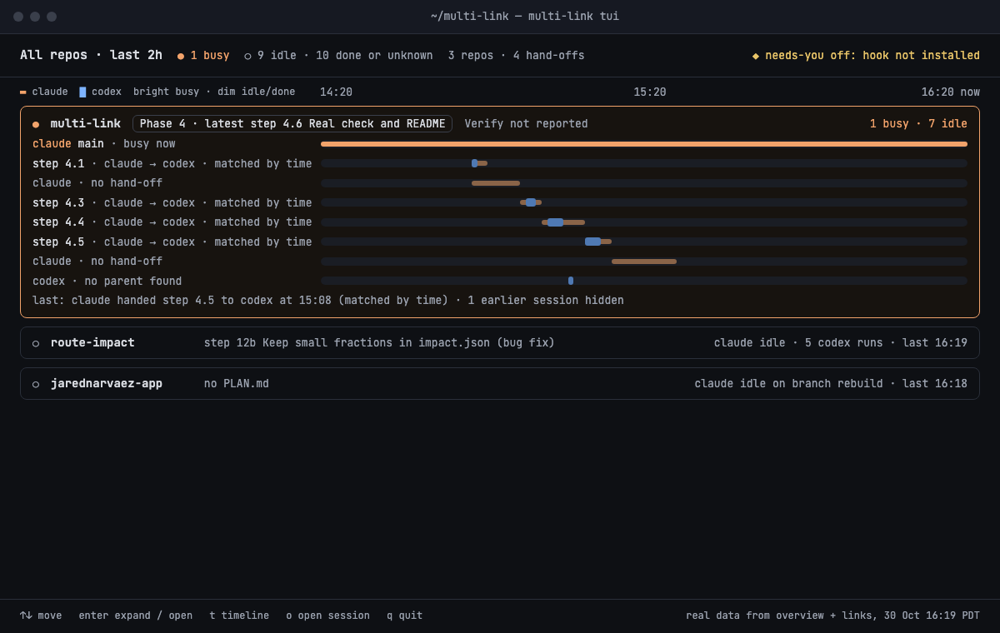
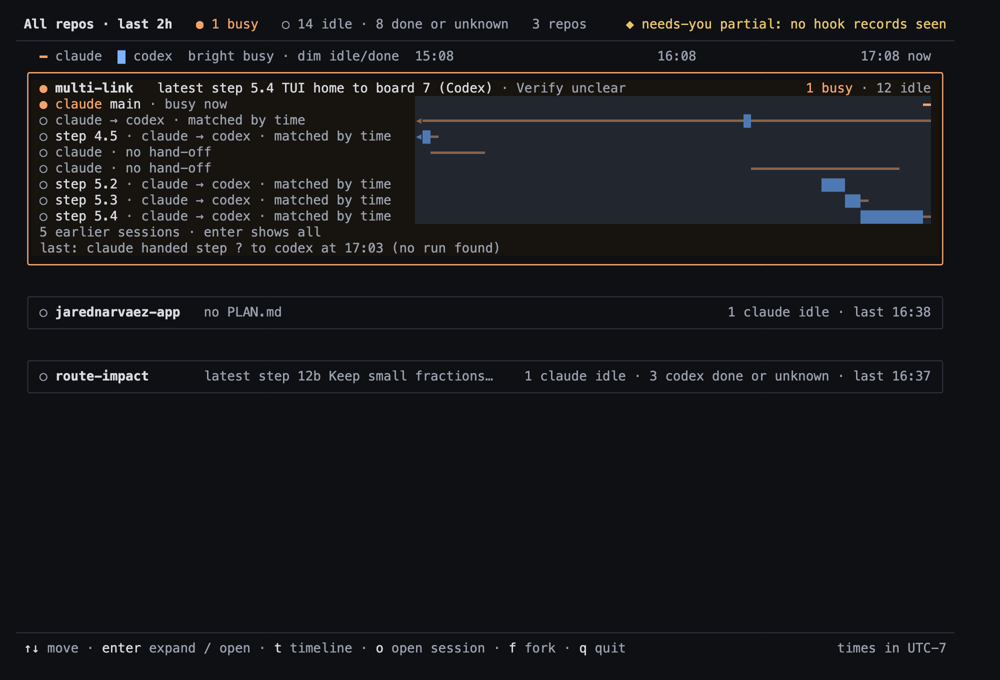
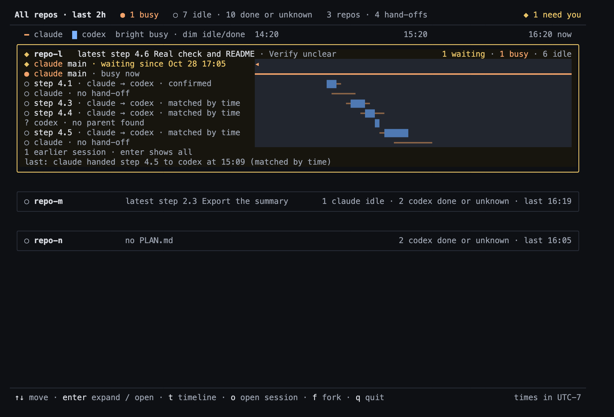

# Phase 5 visual check — 2026-10-30

Step 5.5 compares the rebuilt home screen with **board 7** ("7 · Home target: real data, 30 Oct 16:19"),
the picture the owner approved as the acceptance target for Phase 5. This page shows three images and
lists every difference found. The owner checked the real screen on 2026-11-01 and rejected the bars
(see [Owner check](#owner-check-stop-and-ask--answered-2026-11-01)).

**Most important finding:** in a terminal the lane tracks touch, so the bar area of a card reads as one
dark block with no space between lanes (difference 1). Board 7 separates every lane. This is the first
thing to look at on the real screen.

## How the images were made

- **Home renders:** `crates/tui/examples/home_html.rs` reads `overview --json` and `links --json` output,
  draws the home screen with `render_home_with_options` into a 120×40 buffer (truecolor palette, nothing
  selected, the same options the TUI uses) and writes every cell's character, fg, bg and modifiers as
  HTML. Each row is a block of full-height cells (16 px for 13 px Menlo), so cell backgrounds and `█`
  touch the rows above and below, as they do in a terminal. Commands:

  ```sh
  cargo build --release -p multi-link
  B=target/release/multi-link
  # Fixture (the flags of the phase5 key; offset fixed at UTC−7 like the golden)
  $B overview --root fixtures/sessions-phase5 --now 2026-10-29T23:20:00Z --since all --json > p5-overview.json
  $B links    --root fixtures/sessions-phase5 --now 2026-10-29T23:20:00Z --since all --json > p5-links.json
  cargo run -p multi-link-tui --example home_html -- p5-overview.json p5-links.json p5.html --offset -7
  # Real ~ (the TUI's default 2 h window; local offset)
  NOW=2026-10-31T00:08:56Z
  $B overview --now $NOW --since 2h --json > real-overview.json
  $B links    --now $NOW --since 2h --json > real-links.json
  cargo run -p multi-link-tui --example home_html -- real-overview.json real-links.json real.html
  ```

- **Board 7:** `project/HomeTarget.dc.html` read from the mockup canvas artifact with the Artifact tool,
  rendered locally as plain HTML (the canvas runtime script removed; the markup and inline styles are
  unchanged).
- **Screenshots:** each page was opened and screenshotted in the desktop app's built-in browser pane
  (served from `127.0.0.1`), which showed the same picture as below. Those pane screenshots are small
  JPEG previews, so the committed PNGs were captured from the same HTML files with local headless Chrome:
  home renders at 2× (2000×1360), board 7 at 1× (its own 1200×760 frame).
- **Fixture check:** the text of `p5.html` equals `fixtures/expected/tui/home-phase5.txt` (only trailing
  blanks differ, which the golden trims); `p5-overview.json` equals `fixtures/expected/phase5/overview.json`
  as JSON. The colours are checked cell for cell by the test `phase5_matches_immutable_text_and_styles`.
- **What the images do not show:** the TUI always highlights the selected row (the renders pass no
  selection), and they use the truecolor palette only. A terminal that does not set `COLORTERM` to
  `truecolor`/`24bit` (macOS Terminal.app does not) gets the 256-colour palette, which is close but not
  identical. Line spacing, font and box-drawing joins depend on the owner's terminal.
- Privacy: the images show repo names, step titles from those repos' PLAN.md files, counts and local
  times only. No session ids, paths, prompts or conversation text.

## Images

**Board 7 (target)**



**Real `~`, 2026-10-30 17:08 PDT, default `last 2h`**



**Fixture `fixtures/sessions-phase5` (shaped like board 7, plus a waiting row)**



## Differences from board 7

Board 7 was drawn from real data at 16:19, when Phase 4 was the latest step. The real render is from
17:08, after Phase 5 steps ran, so its rows, steps and counts are different data, not a rule change.
The list below separates what the renderer does differently from what the data shows.

### In every render (layout and drawing)

1. **Lanes touch; the bar area is one dark block.** Every lane's track is a full row of dark cells, and
   terminal rows have no gap, so 7–10 tracks merge into one slab (track `#22262F` on the card is about
   1.2:1) and Codex blocks in neighbouring rows touch (steps 5.2 / 5.3 / 5.4 in the real image). Board 7
   draws each lane as a separate thin rounded bar with space around it. This is the largest visual
   difference, and it comes from the cell grid, not from data.
2. **Cells, not pixels.** Bars are whole terminal cells: Claude is a thin `━` line, Codex a `█` block.
   Board 7 draws smooth bars with sub-cell widths, so short spans (step 4.1, the Codex-only run) look
   larger and blockier here.
3. **Track colour** is `#22262F`, lighter than board 7's `#1A1D24` (5.1 review finding 9: the board's track
   was nearly invisible on the card).
4. **A state glyph starts every lane** (`●` busy, `◆` waiting, `○` idle, `?` unknown). Board 7 has glyphs
   only on cards.
5. **No `Phase N ·` pill** around the plan text; it is plain text. The Verify wording is `Verify unclear`
   where board 7 says `Verify not reported`.
6. **Card title counts:** only `1 busy` (and `1 waiting`) are coloured; `· N idle` is grey. Board 7 colours
   the whole `1 busy · 7 idle` orange.
7. **Hidden-rows line is its own row** (`N earlier sessions · enter shows all`) instead of being appended to
   the `last:` line (`· 1 earlier session hidden`).
8. **Needs-you note wording:** `◆ needs-you partial: no hook records seen` instead of `◆ needs-you off: hook
   not installed` (V8: the screen reports evidence it observed, never "installed").
9. **Idle repo lines** count by harness and state (`1 claude idle · 3 codex done or unknown · last 16:37`)
   where board 7 says `claude idle · 5 codex runs`; there is no branch name (`on branch rebuild`). When the
   counts are long the plan text is cut on a word boundary (`latest step 12b Keep small fractions…`);
   board 7 shows the whole title.
10. **Spacing:** a blank row between cards; no window title bar (that belongs to the terminal). Board 7 uses
    smaller pixel gaps.
11. **Footer** adds `f fork` and ends with `times in UTC-7`; board 7 ends with a provenance note instead.
12. **Font:** the renders use Menlo; board 7 uses JetBrains Mono. In the terminal the owner's own font applies.

### Only on the real render (data the target did not have)

13. **`last: claude handed step ? to codex at 17:03 (no run found)`.** The newest hand-off in multi-link has
    no step and no matching Codex run. V6 does not define wording for a missing step, so the renderer prints
    `?`. It reads like a glitch; a candidate fix is new wording such as `last: claude handed work to codex at
    17:03 (no run found)`.
14. **The header has no `N hand-offs`.** At 120 columns the long needs-you note leaves no room, so the
    narrowing rule drops the hand-off count first (the fixture keeps `4 hand-offs` because its note is the
    short `◆ 1 need you`). Board 7 shows both. The count it would show is also misleading: it is the
    number of links in `links --since 2h` output (14: 9 matched by time with a step, 3 matched by time
    without a step, 2 with no run found), but only 5 of those hand-offs happened inside the 2-hour window;
    the rest belong to sessions that were still active in it. Candidate fix: count hand-offs in the window.
15. **A combined lane without a step:** `claude → codex · matched by time` spans the whole window with one
    Codex block in it. The Claude row and its matched child both have no step, so V2 combines them and V1
    has no step to show. Truthful, but it is the least readable lane on the screen.
16. **`claude main · busy now` is one cell at the right edge**, because the busy session started minutes
    before `now`; board 7's busy row spanned the whole window. Truthful.
17. **Repo order:** `jarednarvaez-app` is above `route-impact` (last activity 16:38 vs 16:37). Board 7 had them
    the other way round at 16:19; same rule, newer data.
18. **12 idle sessions in multi-link:** 7 quiet lanes have activity in the window; the other 5 ended before
    the window start, so they are on the `5 earlier sessions · enter shows all` line (V3 window rule; the
    cap of 8 is not reached). Board 7 had 7 idle lanes and one hidden.

### Only on the fixture render

The fixture differences were listed in 5.1 (design.md, "Phase 5 decisions" → "Target screen"): the added
waiting row from yesterday (yellow card border, `◆ 1 need you`), step 4.1 `confirmed` instead of `matched by
time`, and the Codex-only idle repo `repo-n` in place of `jarednarvaez-app`. The fixture render matches the
5.1 golden exactly, so it adds no new differences.

## Whole-phase Verify (Claude, 2026-10-30)

```text
cargo test --workspace                                → exit 0, 31 `test result: ok`, 0 failed
  incl. phase5_matches_immutable_text_and_styles ... ok   (board-7 fixture == 5.1 golden, text + styles)
  incl. older_keys_only_add_made_and_hook ... ok          (existing keys differ only by `made` / `hook`)
cargo clippy --workspace --all-targets -- -D warnings → exit 0, 0 warning/error lines (crate roots touched)
existing keys vs 7d399ba, `made`/`hook` removed       → overview.json, hook/overview.json,
                                                        phase4/overview.json all equal (Python check)
```

The last two Verify items are the screenshots above and the owner's answer below.

## Owner check (stop-and-ask) — answered 2026-11-01

Need: "from the home screen I can tell in a few seconds which repo needs me and what is running."
The images above are HTML renders of the same buffer the terminal draws; the real terminal (font, colour
support, size) is the owner's to judge. To check:

```sh
cargo build --release -p multi-link
target/release/multi-link tui
```

Owner's answer (2026-11-01, after running Phase 5 on the real screen): the bars on home and the
timeline screen were "really hard to read … random blocks and timestamps on top". **Phase 5 closes as not
meeting the need for its bars.** Why they failed (PLAN.md, Phase 6): a bar ran from a session's start to
its last activity, so a session open for two days filled the window; real work comes in 3–5 minute
bursts, which a 2-hour axis turns into specks; 6 of the rows on the owner's screen were Codex Desktop
imports, not runs. Phase 6 rebuilds home in words (board 7c) and the repo view as swimlanes of recorded
activity (board 8c); see [phase6-check.md](phase6-check.md).
