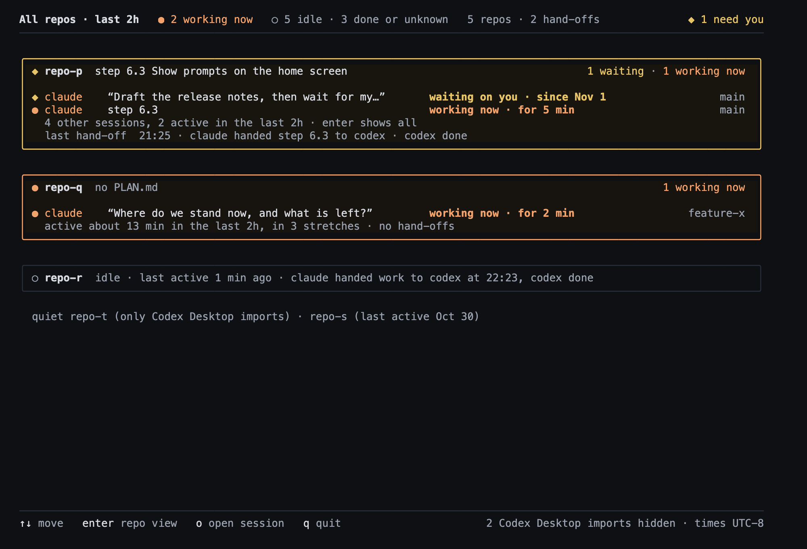
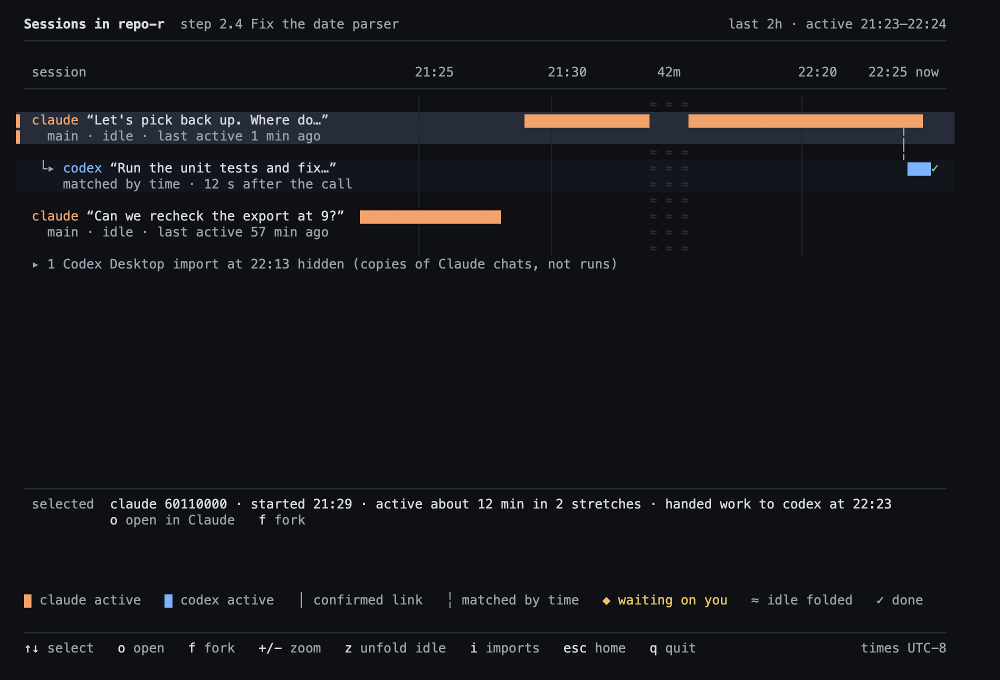

# Phase 6 visual check — 2026-11-02

Step 6.5 compares the rebuilt home screen and the new repo view with the two pictures the owner approved
on 2026-11-01: **board 7c** (home in words) and **board 8c** (repo view as swimlanes). Both boards are on
the owner's private mockup canvas, <https://claude.ai/artifact/R5Bh9iX6bsn3jSu8F8D58C>. They were drawn
from real data and show real prompts, so they are described here, not pictured (W10). The owner still has
to check the real screen (see [Owner check](#owner-check-stop-and-ask--met)).

**Most important findings on real data (2026-11-02 14:07 PST):**
1. Every real Codex run reads `codex · no prompt` (14 of 14 non-imported Codex rows in a 16 h window).
   Today's `codex exec` rollouts carry the prompt in a `response_item` `message` with role `user` and no
   `user_message` event, which is all W3 reads.
2. With `tui --since 16h` the home screen still says `last 2h` (header and `N other sessions, K active in
   the last 2h`); the words are fixed in the home renderer while the data follows `--since`.
3. At the TUI default of 2 h the screen was nearly empty: the Phase 6 work ran the night before, so only
   two repos had activity.

## How the images were made

- `crates/tui/examples/home_html.rs` reads `overview --json` and `links --json` output and writes every
  cell of a 120×40 buffer (character, fg, bg, modifiers) as HTML. Without `--repo` it draws home with
  nothing selected. `--repo NAME` draws that repo's view as the TUI opens it: fitted range, folds on,
  imports hidden, first lane selected (as the TUI opens it from the repo's title line). `--since` gives the repo view the same report window the TUI builds
  from its own `--since` (default `2h`). Commands:

  ```sh
  cargo build --release -p multi-link
  B=target/release/multi-link
  F=(--root fixtures/sessions-phase6 --now 2026-11-03T06:25:00Z --since 2h --json)   # zsh: an array
  $B overview $F > p6-overview.json
  $B links    $F > p6-links.json
  cargo run -p multi-link-tui --example home_html -- p6-overview.json p6-links.json p6-home.html --offset -8
  cargo run -p multi-link-tui --example home_html -- p6-overview.json p6-links.json p6-repo.html --offset -8 --repo repo-r
  ```

  Real `~` used the same commands without `--root`, with `--now 2026-11-02T22:07:21Z` and `--since 2h`
  (the TUI default) and again with `--since 16h` (to cover the Phase 6 work of the night before; the
  example's repo render then also takes `--since 16h`), and the local offset (UTC−8). Those renders and their screenshots stay in scratch storage (W10).
- **Screenshots:** local headless Chrome at 2× (2000×1360) from the HTML files.
- **Fixture check:** the text of both fixture HTML pages equals `fixtures/expected/tui/home-phase6.txt` and
  `repo-phase6.txt` (a Python check over the cells); `p6-overview.json` equals
  `fixtures/expected/phase6/overview.json` as JSON. Colours are checked cell for cell by the tests
  `phase6_matches_immutable_text_and_styles` and `phase6_repo_matches_immutable_text_and_styles`.
- **What the images do not show:** the truecolor palette only (a terminal without `COLORTERM=truecolor`
  gets the 256-colour palette); font, line spacing and box-drawing joins are the owner's terminal's.
- Privacy: the fixture prompts and ids are synthetic (6.1). No real render is committed.

## Fixture renders

**Home, `fixtures/sessions-phase6`, 120×40, UTC−8, nothing selected**



**Repo view on `repo-r`, same fixture, parent lane selected**



## The boards, in words

**Board 7c (home).** No timeline and no bars. A header line with the working, idle and done counts and
the needs-you note. Each repo that needs attention is a rounded card: the repo name and its latest PLAN.md
step in the title, `N working now` on the right; one line per working or waiting session with its
harness, a label (the step, or the session's first prompt in quotes), a status phrase such as `working now
· for N min` and the branch at the right; one grey line counting the other sessions; one line naming the
last hand-off in words. A repo with only idle activity is a single bordered sentence (`idle · last active
1 min ago · claude handed work to codex at 22:23, codex done`). Repos without activity share one `quiet`
line. The footer counts the hidden Codex Desktop imports and names the time zone.

**Board 8c (repo view).** Board 2's swimlanes on real data. A title with the repo and its step, then a
time axis that starts at the first activity and ends at `now`. One lane per session, newest first, each
two text rows: a label with the bars to its right, then a dim sub line (branch and status). Claude bursts
are orange blocks, Codex bursts blue; a Codex run started by a Claude session sits nested under it (`└▸`,
darker row) with a dashed line from the hand-off point and `matched by time · N s after the call` as its
sub line; `✓` marks a finished run. A `selected` line, a legend and a key footer close the screen.

The fixture renders match the boards region by region; the deliberate differences (PLAN wins) were listed
in the 6.1 review (PROGRESS.md): a 5-column fold with its length in the axis row, W5 sub lines, "active"
instead of "worked", `│ confirmed link` and `✓ done` in the legend, `o open` and `i imports` in the footer.

## Real data compared with the boards (counts, no prompts)

Real `~` at 2026-11-02 14:07 PST. Counts come from the scratch JSON of that run.

### Default window (`--since 2h`, what `multi-link tui` shows)

- 4 repos: 2 with activity (one card for multi-link with 1 working session, one idle sentence for
  physaflow), 2 on the `quiet` line. No imports in the window, so no footer note.
- The multi-link repo view had 2 lanes over a fitted range of 14:05–14:07 (2 minutes), no folds, no
  hand-offs. Its axis printed `14:07` as a tick and again as `14:07 now` because `now` was 14:07:21: the
  tick rule only skips a tick exactly at `now`.
- Both multi-link Claude sessions read `claude · no prompt` (see below).

### Wider window (`--since 16h`, covering the Phase 6 work)

- 5 repos: 1 card, 2 idle sentences, 2 on the `quiet` line; 7 Codex Desktop imports hidden (footer), one
  repo listed as `(only Codex Desktop imports)`.
- multi-link: 8 Claude and 8 Codex sessions; 6 Codex runs are nested under their Claude parent with
  `matched by time` (0, 1 and 2 s after the call for step 6.3); 0 confirmed links. The lanes, link lines,
  `✓` marks and the 13 h overnight fold band draw as on board 8c (the fold's length label does not, see 5
  below). The fitted range is 22:22–14:07, and 8 of
  the lanes fit on one 40-row screen; the rest scroll.

### Differences from the boards seen only on real data

1. **`codex · no prompt` on every Codex run.** 14 of 14 non-imported Codex rows in the 16 h window have
   `asked` null. A real rollout of 2026-11-02 has 2 `response_item` `message` records with role `user` and
   no `user_message` event; W3 reads only `user_message`. The lane then reads `codex codex · no prompt`
   (harness, then a fallback that repeats it). Board 8c showed each run's prompt. Core change needed.
2. **`claude · no prompt` on sessions started by another session.** 4 of 8 multi-link Claude sessions.
   In the one checked (this step's own session) the first user record starts with `<system-reminder>`,
   which W3 skips as a wrapper. Same repeated-harness reading as above.
3. **`last 2h` with `--since 16h`.** The home header and the card's rest line keep the fixed words `last
   2h`; the repo view's title follows the window (`last 16h`). Board 7c was drawn at the default window.
4. **Two Codex runs with no parent.** The two newest multi-link Codex runs (done 00:11 and 00:17) are
   top-level lanes with no link, so the card's `last hand-off` still names step 6.3 (Nov 1). Board 8c had
   every run nested.
5. **Fold length missing.** The 13 h overnight fold sits just left of the `now` label; its length label is
   not drawn (no room before `14:07 now`), so the band has no length on screen.
6. **Dates instead of times after midnight.** A session last active at 23:53 the night before reads
   `last active Nov 1` (W5: a clock time only on `now`'s local date).
7. **A near-empty default screen.** At 2 h the data is one working session and one idle repo; the screen
   is correct but shows little, unlike the boards, which were drawn mid-session.

## Whole-phase Verify (Claude, 2026-11-02)

```text
cargo test --workspace                                → exit 0, 35 `test result: ok`, 0 failed
  incl. phase6_matches_immutable_text_and_styles ... ok        (home == 6.1 golden, text + styles)
  incl. phase6_repo_matches_immutable_text_and_styles ... ok   (repo view == 6.1 golden, text + styles)
cargo clippy --workspace --all-targets -- -D warnings → exit 0, 0 warning/error lines
existing keys vs 1739a67, four Phase 6 fields removed → overview, sessions, hook/{overview,sessions,
                                                        sessions-2h}, phase4/overview, phase5/overview:
                                                        7 of 7 equal (Python check)
fixture HTML text vs goldens                          → home True, repo True
```

The remaining Verify items are the real screenshots shown to the owner from scratch storage and the
owner's answer below.

## Owner check (stop-and-ask) — met

Need: "from the home screen I can tell in a few seconds which repo needs me and what is running; from a
repo I can see which Codex run came from which Claude session, when each was active, and how sure the link
is." To check:

```sh
cargo build --release -p multi-link
target/release/multi-link tui
target/release/multi-link tui --since 16h   # to see last night's Phase 6 runs in the repo view
```

Owner's answers (2026-11-02), after running `multi-link tui` on the real screen:
1. On the route-impact repo view: "make it look like 2, the connections between the timelines to show the
   hand-offs". The view already drew the connection; the link itself was missing (a launch inside `( … )`
   after a heredoc). Step 6.6 fixed the recogniser (real launches found across all history: 124 → 149) and
   the Codex prompt labels.
2. After 6.6: "add the label wording done like in the design; other than that it looks good". Step 6.7
   draws `✓ done` after a finished Codex bar when it fits.

**Result: Phase 6 meets the need** (owner approved the real screen with 6.7's label as the only change).
