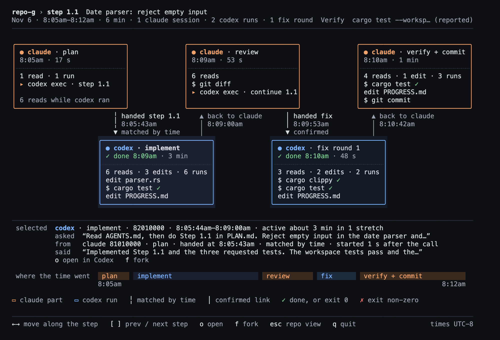

# Phase 8 real check — 2026-11-08

Step 8.6 compares the step graph (G0–G11, `PLAN.md` → Phase 8, `docs/design.md` → "Phase 8 decisions") with
**board 9**, the picture the owner approved on 2026-11-06, and runs it on real data. Board 9 is on the owner's
private mockup canvas, <https://claude.ai/artifact/R5Bh9iX6bsn3jSu8F8D58C>. It was drawn from real step 6.7 and
shows real prompts, so it is described here, not pictured (W10). The real renders show prompts too; they stayed in
scratch storage and are described in words and counts only. The owner's check is still open (see
[Owner check](#owner-check-stop-and-ask--confirmed)).

**Most important findings on real data (release build at 0ec1283, `--now 2026-11-09T00:00:00Z`):**
1. Real step 6.7 draws board 9's layout: the same 5 parts in the same slots, the same edge glyphs, words and clock
   times, and the same panel lines. The differences are G5/G6 call counting and labels, whole-minute rounding (W5)
   and two pieces of wording. All are listed below.
2. **Most "lost" Codex rollouts look compressed, not deleted.** On 2026-11-08, `~/.codex/sessions` holds 202
   `rollout-*.jsonl.zst` files next to 211 plain `rollout-*.jsonl`. multi-link reads only plain `.jsonl`, so it
   never sees the compressed runs. Of the 116 unlinked hand-offs, 81 have a `.zst` rollout whose file name time is
   0–10 s after the hand-off (43 of the 81 carry a step tag); one pair (step 3.7) was confirmed by content. 17 more
   have a plain rollout that close (likely link misses) and 18 have neither; 24 unlinked hand-offs are dated after the
   last `.zst` folder, so compression does not explain all of them. This revises Phase 8's earlier reading that
   rollouts disappear (PLAN.md, "Measured 2026-11-06"). Which program compresses them was not investigated. Reading `.zst` is
   outside Phase 8 (non-goal: explaining or recovering missing rollouts), so it is a follow-up.
3. Step 6.6's unlinked part is a link miss, not a lost rollout. Its fix hand-off was `codex exec resume --last`,
   which names no session id. The resumed turn went into the implement run's rollout, so the implement box counts
   both turns and the fix part reads `no codex run found`.

## How the renders were made

`multi-link graph` writes the same report the TUI draws, and the `home_html` example renders a report to HTML, one
`<span>` per cell of the 120×40 buffer (Step 8.4). Screenshots come from local headless Chrome at 2× (2000×1360).

```sh
cargo build --release -p multi-link
cargo build --release -p multi-link-tui --example home_html
B=target/release/multi-link; E=target/release/examples/home_html
# fixture (the committed image)
$B graph --root fixtures/sessions-phase8 --now 2026-11-06T18:00:00Z --repo /home/dev/repo-g --step 1.1 --json > p8.json
$E --graph p8.json p8.html --offset -8 --selected 1
# real data (scratch only)
$B graph --repo "$PWD" --step 6.7 --now 2026-11-09T00:00:00Z --json > g6.7.json
$E --graph g6.7.json g6.7.html --offset -8 --selected 1    # 6.6 the same; 3.7 with --offset -7 (Oct 30 was PDT)
```

`--selected 1` selects the first Codex part, as board 9 does. Checks on the fixture render: `p8.json` equals
`fixtures/expected/phase8/graph-1.1.json` as JSON (`True`), and the HTML's text equals
`fixtures/expected/tui/step-phase8.txt` line by line (`diff` prints nothing). Colours are checked cell by cell by
the Step 8.4 golden test. The image shows the truecolor palette only. A terminal without `COLORTERM=truecolor` gets
the 256-colour palette. Font, line spacing and box-drawing joins depend on the owner's terminal.

8.6 did not drive the live TUI. The real renders come from the report through `home_html`, which is the TUI's own
render function. The `s` key, `←→`, `[ ]`, `o`/`f` and refresh are covered by Step 8.5's app tests on fixtures. The
owner's check below covers them on real data.

## Fixture render



*`fixtures/sessions-phase8`, step 1.1, 120×40, UTC−8, `implement` selected. Synthetic prompts and ids.*

## Board 9 in words

Board 9 is a 120×40 cell drawing of multi-link step 6.7 ("Repo view: `✓ done` label after a finished Codex run"),
Nov 2, 16:37–16:44 PST, made by hand from that step's transcripts:
- **Header (rows 0–2):** `multi-link › step 6.7` and the PLAN.md title; on the right a green `✓ committed 0190090 ·
  16:44`. Line 2: `Nov 2 · 16:37–16:44 · 7 min · 1 claude session · 2 codex runs · 1 fix round` and on the right
  `Verify cargo test --workspace (reported)`. A rule under it.
- **Claude lane (rows 4–12):** three orange boxes, 30 cells wide, at columns 1, 45 and 89: `plan` (16:37 · 17 s,
  `1 read · 1 run`, `▸ codex exec · step 6.7`, grey `6 reads while codex ran`), `review` (16:41 · 53 s, `6 reads`,
  `$ git diff`, `▸ codex exec · continue 6.7`) and `verify + commit` (16:42 · 1½ min, `4 reads · 3 runs · 1 edit`,
  `$ cargo test, clippy, fmt ✓`, `edit PROGRESS.md`, `$ git commit → 0190090`).
- **Edges (rows 13–15):** two dashed `╎` hand-offs (`handed step 6.7` at 16:37:43 and `handed fix` at 16:41:53, both
  `matched by time`) and two grey `▲ back to claude` returns (16:40:59, 16:42:42).
- **Codex lane (rows 16–24):** two blue boxes on a dark fill at columns 23 and 67: `implement` (`✓ done 16:40 · 3 min`,
  `6 reads · 5 edits · 4 runs`, `edit timeline.rs + tests`, `$ cargo test --workspace ✓`, `edit PROGRESS.md`) and
  `fix round 1` (`✓ done 16:42 · 48 s`, `3 reads · 2 edits · 2 runs`, `edit timeline.rs`, `$ cargo clippy, test ✓`,
  `edit PROGRESS.md`). `implement` has the selection fill.
- **Panel (rows 27–31):** `selected codex · implement · <id> · 16:37:44–16:40:59 · active about 3 min in 1 stretch`,
  then `asked` (the hand-off prompt, quoted and cut), `from claude <id> · plan · handed at 16:37:43 · matched by time ·
  started 1 s after the call`, `said` (the run's last message, quoted and cut), `o open in Codex   f fork`.
- **Strip (rows 33–34):** `where the time went`, five filled cells in part colours (`plan`, `implement`, `review`,
  `fix`, `verify + commit`), `16:37` under the left end and `16:44` at the right.
- **Legend (row 36)** `▭ claude part ▭ codex run ╎ hand-off matched by time │ confirmed (hook) ✓ done` and the
  **footer (row 39)** `←→ move along the step [ ] prev / next step o open f fork esc repo view q quit`, `times PST`.

## Real step 6.7 against board 9, region by region

The real render puts the same 5 parts in the same slots: Claude boxes at columns 1, 45 and 89, Codex boxes at 23
and 67, edges at the same columns. The same colours were checked on the screenshot: orange Claude borders, blue
Codex borders on the dark fill, the selection fill on `implement`, green `✓`. Differences:

| Region | Board 9 | Real render | Why |
| --- | --- | --- | --- |
| Header line 1 | title without backticks and `(Codex)` | PLAN.md title as written: `` Repo view: `✓ done` label after a finished Codex run (Codex) `` | G7 prints the PLAN.md title; the board shortened it |
| Header line 2 | `7 min` | `6 min` | the chain runs 00:37:26–00:44:16 UTC (6 min 50 s); W5 floors to whole minutes |
| plan box | `1 read · 1 run` | `2 reads` | G6 does not count hand-offs, so the `codex exec` call is not a run; the transcript has 2 owned reads |
| review box | `16:41 · 53 s` | `16:40 · 54 s` | the part starts at the return, 16:40:59, and lasts 54.0 s (the board rounded the start up) |
| verify + commit box | 16:42 · `1½ min`; `4 reads · 3 runs · 1 edit`; `$ cargo test, clippy, fmt ✓`, `edit PROGRESS.md`, `$ git commit → 0190090` | 16:42 · `1 min`; `5 reads · 4 runs`; `$ cargo build ✓`, `$ git diff`, `$ git commit` | W5 whole minutes (93 s); counts in reads, edits, runs order (G6); a PROGRESS.md write through the shell is a run (G5); one fixed label per line, the 3 newest; nothing copied from a result (G6) |
| implement box | `6 reads · 5 edits · 4 runs`; `edit timeline.rs + tests`, `$ cargo test --workspace ✓`, `edit PROGRESS.md` | `6 reads · 2 edits · 7 runs`; `$ cargo test ✓`, `edit timeline.rs`, `$ git diff` | 15 calls either way: 3 file writes made through the shell count as runs (G5). Fixed labels drop `--workspace` and `+ tests` (G6) |
| fix round 1 box | `✓ done 16:42 · 48 s`; `3 reads · 2 edits · 2 runs`; `edit timeline.rs`, `$ cargo clippy, test ✓`, `edit PROGRESS.md` | `✓ done 16:42 · 47 s`; `2 reads · 1 edit · 4 runs`; `edit timeline.rs`, `$ cargo clippy`, `$ git diff` | 7 calls either way; one edit is a run (G5) and one board read is a run in the report (not traced); the run lasted 47.9 s, floored; `$ cargo clippy` has no mark because its Codex output holds no `exit_code` (`ok` null, G5) |
| Edges | as above | identical words, glyphs and clocks | both real links are matched by time (gaps 1.3 s and 1.4 s) |
| Panel | `said` cut mid-sentence at column 108 | cut one word earlier | quoted text ends on a word boundary (G8) |
| Strip | widths 8, 32, 14, 10, 26 | 8, 31, 14, 10, 27 | the written share rule (design.md, Strip). Measured from the cell backgrounds of row 33 |
| Legend | `╎ hand-off matched by time`, `│ confirmed (hook)`, `✓ done` | `╎ matched by time`, `│ confirmed link`, `✓ done, or exit 0`, `✗ exit non-zero` | W8 wording (any exact evidence, not only the hook); `✓`/`✗` say what they mean (G6) |
| Footer | `times PST` | `times UTC-8` | only the offset is known (as Phase 6) |

In the two Codex boxes the call totals match the board (15 and 7) and 4 of the board's edits are runs in the report
(implement 3, fix round 1 1). That is G5 on purpose: telling a file write from shell text would be a guess. In
verify + commit the report counts 9 calls with no edit where the board drew 8 with one edit. 8.6 did not trace which
call the board drew as that edit.

## Real step 6.6 (an unlinked part)

Step 6.6 ("Linker: launches in subshells and after heredocs; prompt labels"), Nov 2, 16:20–16:29 PST, committed
86f6299. **4 parts:** `plan` (52 s, `2 reads · 4 runs`, both hand-offs `▸ codex exec · step 6.6` and `▸ codex exec ·
continue 6.6`, `9 reads while codex ran`), `implement` (`✓ done 16:27 · 5 min`, `13 reads · 12 runs`, active about
4 min in 2 stretches), `fix round 1` (dim `no codex run found`, no counts) and `verify + commit` (2 min, `8 reads · 6
runs`, `$ git diff`, `$ git commit`). The first edge is `╎ matched by time`. The second is `╎ no run found` with no
return arrow. The header says `1 codex run · 1 fix round`.

What happened: the fix hand-off (16:27:08) was `codex exec resume --last`. `--last` names no session id, so no link
is exact or matched by time. The resumed turn started 1.5 s later inside the implement run's own rollout, which holds
two turns (00:21:51–00:26:13 and 00:27:10–00:27:44 UTC). G4 gives a run the turns that start in its window. With no
linked child after it, the implement window is open, so `implement` owns both turns. That makes the box 5 min with 2
stretches and puts the fix's calls in it. The fix hand-off falls inside that interval, so there is no Claude
`review` part between the two Codex parts (G2: a hand-off during a run makes two Codex parts neighbours), and the fix
part's `from` line names `plan` as the part that handed it. The strip reads 11, 45, 5, 30 cells. The panel of the
fix part says `(the rollout may be gone)`, which is wrong here: the run is in the implement rollout. G4's wording
assumes a missing rollout. A resume without an id is a link miss.

## Real step 3.7 (a compressed rollout)

Step 3.7 ("`multi-link tui`: loop, refresh, keys, bell, open"), Oct 30, 03:40–04:11 PDT, committed a2fd891 at
03:52. **5 parts, 0 codex runs:** `plan` (19 s, `3 reads · 1 run`, `$ git diff`, `$ git commit`, `▸ codex exec · step
3.7`), `implement` and `fix round 1` (both dim `no codex run found`, edges `╎ no run found`, no returns), `review`
(03:40 · 9 min, `6 reads · 1 run`) and `verify + commit` (03:49 · 21 min, `5 reads · 2 runs`, `$ git diff`, `$ cargo
test ✓`, `$ git commit`). The panel says `(the rollout may be gone)`. The strip reads 6, 11, 21, 5, 47.

Readings worth knowing:
- The `review` box runs through the time Codex worked, because an unlinked run has no interval (G2). Its 9 minutes
  are not 9 minutes of Claude review.
- `plan` holds a `$ git commit`. The parent's burst began with the previous step's commit, and G3 names the part
  before the first hand-off `plan` whatever it holds.
- `verify + commit` ends at 04:11, 19 minutes after the commit, because the chain ends with the parent's last burst
  (G2), and the session kept working after it.
- The first hand-off's rollout is on disk as `rollout-2026-10-30T03-40-52-….jsonl.zst`. Its first record is a
  `codex_exec` session in `multi-link`, started 10:40:52.901Z, 1.6 s after the hand-off at 10:40:51.318Z. The
  second hand-off (10:49:55Z) has no rollout file starting within 10 s.

## Missing rollouts in numbers (2026-11-08)

Counts only, from `find ~/.codex/sessions` and `multi-link links --since all --json` at the same `--now`:

| Measure | Count |
| --- | --- |
| `rollout-*.jsonl.zst` files (compressed), by folder dated 2026-10-16 to 2026-10-30 | 202 |
| `rollout-*.jsonl` files (plain, read by multi-link), by folder dated 2026-10-29 to 2026-11-08 | 211 |
| Hand-offs (`links`) | 203 |
| Unlinked hand-offs | 116 |
| Unlinked hand-offs dated before 2026-10-31 | 92 |
| Unlinked hand-offs with a `.zst` rollout whose file name time is 0–10 s later | 81 (43 with a step tag) |
| Unlinked hand-offs with a plain rollout whose file name time is 0–10 s later | 17 |

The 0–10 s count compares file name times (local time) with hand-off times. It is not the linker's rule and does
not claim the pairs would link. It only shows that most "lost" runs are on disk.

## Step 8.4's own graph

Step 8.4 ran in the hybrid mode (Claude split tasks, Codex wrote each one). Its graph is the largest real one:
25 tagged hand-offs (10 `exec`, 15 `resume`), **51 parts in 1 chain**. The Codex parts are named `implement` and
`fix round 1` … `fix round 24`, because G3 names parts by position. They come from 8.4's 28 Codex calls: 7 test halves, 7 code halves
(each a `codex exec resume` of its test half) and 14 review fix calls (PROGRESS, Step 8.4). The first calls went
through a wrapper script, are untagged and are not drawn. 15 Codex
parts are done and 10 are unlinked. On 2026-11-07, when the graph had 8 runs, PROGRESS traced 6 unlinked ones to
a wrapper script and a `cd` prefix the linker does not follow; the later ones were not traced. This is G3's limit in
its plainest form. README says so.

## Whole-phase Verify (Claude, 2026-11-08, HEAD 0ec1283)

```text
cargo test --workspace                                → exit 0, 49 test binaries, 519 passed, 0 failed, 1 ignored
cargo clippy --workspace --all-targets -- -D warnings → exit 0
phase8 fixture render vs fixtures/expected/tui/step-phase8.txt  → text equal (diff prints nothing); styles by the 8.4 test (passes)
step-phase8.txt / .styles.txt history                 → one commit, 8448da9 (Step 8.1): unchanged since
graph-1.1 report vs fixtures/expected/phase8/graph-1.1.json     → equal (all 13 answer-key files checked by crates/cli/tests/graph.rs)
existing JSON keys since e5f6c78 (amended check):
  git diff --diff-filter=MD e5f6c78 -- fixtures/expected ':!fixtures/expected/tui' \
    | grep '^[-+] ' | grep -v '"title"' | grep -v '"started_by"' | wc -l           → 0
existing text goldens changed since e5f6c78           → home-hook{,-full}{,.styles}.txt (8.4b: titled hook session)
                                                        repo-phase6{,.styles}.txt (8.5: footer gains `s step`)
real step 6.7 vs board 9                              → compared region by region above
```

The pinned `git diff --exit-code --diff-filter=MD e5f6c78 -- fixtures/expected/` now exits 1, as the amendment above
Step 8.4a allows: from 8.4a on, each step checked that only its own keys changed. The one-line check above repeats
8.4b's and 8.4c's checks across the whole phase.

**W10 over the files this step commits** (`docs/phase8-check.md`, `README.md`, `docs/img/step-phase8-fixture.png`,
`PROGRESS.md`): no prompt or agent message text (the real `asked`/`said` lines are described, never quoted), no
session ids (only this repo's commit hashes and synthetic fixture ids), no `/Users/` path, no secrets. The image is
the synthetic fixture. Board 9 and the real renders stay out of the repo.

## Owner check (stop-and-ask) — confirmed

Need (design need 4): "for one PLAN.md step I can follow who did what, in what order, how many fix rounds it took
and how it ended, across Claude and Codex, without opening transcripts." To check (the installed binary predates the
step graph, so reinstall first):

```sh
cargo install --path crates/cli --force
multi-link tui
```

Then `enter` on a repo, select a lane, and press `s`. Use `←→` to move along parts, `[ ]` for the previous or next
step, and `esc` to go back.

Owner's answer (2026-11-08, after reinstalling and running `multi-link tui` with Step 8.7's 12-hour clock): "it looks good", then "Yes, close Phase 8". Phase 8 is closed.
