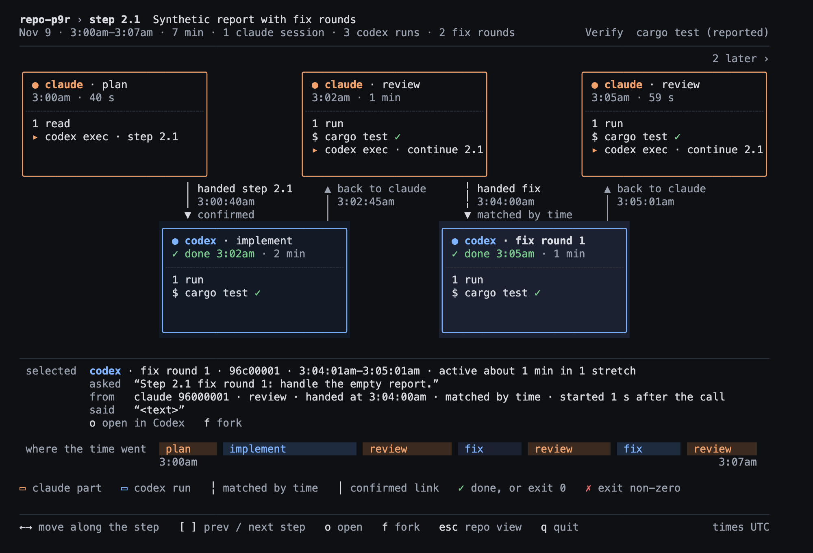

# Phase 9 real check (Step 9.7)

Phase 9 ("Truthful states and links", Release 1.6) set out to make the screens say less "unknown": a Claude session
that ended should say so and be reopenable, and a hand-off whose Codex run is still on disk should find it. This page
holds the real counts before and after each step, why ambiguous links rose, the real gaps behind R7's 10 s window,
step 8.7's graph, the fixture images and the owner's check.

Everything here rests on formats that Claude Code and Codex do not document: compressed rollouts, `cost-state`,
`entrypoint`, the desktop app's session records, `task_started` turns and the `session id:` line in Codex's output.
The one documented piece is the `SessionEnd` hook event. Counts change as new sessions are added.

## Method

Each Phase 9 commit was extracted with `git archive` into scratch and built in release mode with its own target
directory. All eight binaries ran against the same real `~` at one fixed clock, `--now 2026-11-09T00:34:07Z`
(2026-11-08, 4:34pm local), with
`--since all`, from an empty scratch folder. A scratch script parsed the JSON in memory and kept only counts. A small
scratch Rust program per commit used that commit's own core crate to work out each Claude session's open action
without running it, the same way Step 9.2 did. Nothing was written to `~/.claude` or `~/.codex`, and no real JSON,
render or id is committed (W10).

| Column | Commit | Step |
|---|---|---|
| before | `6a2c306` | Phase 8 closed |
| 9.0+9.6a | `0d490ce` | rules and fixtures (no code), session folder rule |
| 9.1 | `531aeeb` | read `.jsonl.zst` rollouts |
| 9.2 | `fb2da53` | clean exit from the transcript; reopen by entrypoint |
| 9.3 | `d6edf92` | hand-off child from the redirect file |
| 9.4 | `6e82309` | `SessionEnd` hook record |
| 9.5 | `8416429` | Codex lane's step from all-time hand-offs |
| 9.6 = HEAD | `a223dc1` | `codex exec resume --last` fix rounds |

## Codex sessions

| | before | 9.0+9.6a | 9.1 | 9.2 | 9.3 | 9.4 | 9.5 | 9.6 |
|---|---|---|---|---|---|---|---|---|
| Codex sessions | 223 | 223 | 425 | 425 | 425 | 425 | 425 | 425 |
| of them read from `.jsonl.zst` | 0 | 0 | 202 | 202 | 202 | 202 | 202 | 202 |
| of them Codex Desktop imports | 129 | 129 | 231 | 231 | 231 | 231 | 231 | 231 |
| state `unknown` / `turns_complete` | 223 | 223 | 424 | 424 | 424 | 424 | 424 | 424 |
| state `unknown` / `no_signal` | 0 | 0 | 1 | 1 | 1 | 1 | 1 | 1 |
| skipped records (all files) | 2489 | 2489 | 2497 | 2497 | 2495 | 2495 | 2495 | 2495 |

Every command exited 0 with empty stderr. Codex states did not change: Phase 9 adds no Codex exit evidence, so a
Codex run still shows `done` only when its last turn completed (a non-goal).

## Claude sessions: state, entrypoint and open action

247 Claude sessions at every commit. Before 9.2 every column is the same as `before`, and from 9.2 on every column
is the same as 9.2 (checked group by group).

| state / evidence | entrypoint | open action | before | 9.2 → HEAD |
|---|---|---|---|---|
| `busy` / `session_record` | `claude-desktop` | app link | 1 | 1 |
| `idle` / `session_record` | `claude-desktop` | app link | 14 | 14 |
| `unknown` / `no_signal` | `claude-desktop` | unavailable (`not_known_finished`) | 195 | 0 |
| `unknown` / `no_signal` | `cli` | unavailable (`not_known_finished`) | 28 | 2 |
| `unknown` / `no_signal` | `sdk-cli` | unavailable (`not_known_finished`) | 5 | 0 |
| `unknown` / `no_signal` | missing | unavailable (`not_known_finished`) | 4 | 1 |
| `finished` / `transcript_exit` | `claude-desktop` | app link | 0 | 123 |
| `finished` / `transcript_exit` | `claude-desktop` | unavailable (`app_session`: no app record, or two) | 0 | 72 |
| `finished` / `transcript_exit` | `cli` | resume | 0 | 26 |
| `finished` / `transcript_exit` | `sdk-cli` | resume | 0 | 5 |
| `finished` / `transcript_exit` | missing | unavailable (`unknown_entrypoint`) | 0 | 3 |
| **total `unknown`** | | | **232** | **3** |
| **total `finished`** | | | **0** | **229** |

`session_end` is 0 at every commit. The 9.4 hook snippet is not yet in the owner's `~/.claude/settings.json`, so
real sessions write no `ended` records yet. That is the first item of the owner check below.

## Links

| | before | 9.0+9.6a | 9.1 | 9.2 | 9.3 | 9.4 | 9.5 | 9.6 |
|---|---|---|---|---|---|---|---|---|
| hand-offs | 222 | 222 | 222 | 222 | 222 | 222 | 222 | 221 |
| unlinked | 124 | 124 | 59 | 59 | 53 | 53 | 53 | 47 |
| heuristic (matched by time) | 69 | 69 | 126 | 126 | 116 | 116 | 116 | 121 |
| of them `resume_turn` | – | – | – | – | – | – | – | 5 |
| exact | 28 | 28 | 28 | 28 | 44 | 44 | 44 | 44 |
| exact `resume_arg` | 16 | 16 | 16 | 16 | 16 | 16 | 16 | 16 |
| exact `redirect_file` | – | – | – | – | 16 | 16 | 16 | 16 |
| exact `stdout` | 10 | 10 | 10 | 10 | 10 | 10 | 10 | 10 |
| exact `thread_ready` | 2 | 2 | 2 | 2 | 2 | 2 | 2 | 2 |
| ambiguous | 1 | 1 | 9 | 9 | 9 | 9 | 9 | 9 |

- **9.1** moved 65 hand-offs out of unlinked by reading `.zst` runs: 57 now matched by time, 8 ambiguous. **9.3** turned 10 time matches and 6 unlinked hand-offs into
  `redirect_file` exact links. **9.6** linked 5 `resume --last` fix rounds and dropped one hand-off: this repo's own
  `codex exec … resume --help` probe, which is now a help call and not a hand-off.
- 47 unlinked remain. 3 of them are `resume --last` hand-offs that R7 refuses on purpose (see R7 below).

## Why ambiguous links rose from 1 to 9

All 8 new ambiguous links came with 9.1, and the cause is that the `.zst` runs became visible. All 8 are hand-offs
from 2026-10-30, and every candidate they have is a run read from
`.jsonl.zst`. Each has one run starting 0.5–1.8 s after the hand-off and at least one more run in the same checkout
starting 3.0–58.7 s after it, inside the 60 s creation window. One hand-off has four candidates; the others have two.
In 4 of the 8, the further run is matched by time to a different Claude session's hand-off. In the other 4 it is
linked to nothing. Before 9.1, those runs were not read, so each of these hand-offs had no candidate and counted as
unlinked.

The rule is doing what it says. It does not pick the nearest run when two runs in one checkout start within 60 s,
because parallel sessions in one checkout make "nearest" a guess. The one ambiguous link from before (2026-11-03,
two plain runs at 1.6 s and 54.7 s) is unchanged. Preferring a run that starts much sooner than the others, or
leaving out a run already matched to another hand-off, could settle most of the 9, but that is a new link rule.
It is not part of Phase 9.

## R7: the real gaps behind the 10 s window

R7 links a `codex exec resume --last` hand-off to a later turn of an existing run that starts 0–10 s after it. The
10 s was a conservative, uncalibrated choice. Real data has 13 `resume --last` hand-offs, out of 29 hand-offs whose
form is `resume`. The other 16 name an id and stay exact `resume_arg`.

| outcome | hand-offs | gap to the nearest later turn in the same checkout |
|---|---|---|
| heuristic `resume_turn` | 5 | 1.48, 1.49, 1.57, 1.83, 2.71 s (the links' `gap_ms`) |
| exact `redirect_file` (observed id wins) | 5 | 0.8, 1.0, 1.5, 1.6, 2.0 s |
| unlinked (a `cd` in a subshell before the launch) | 3 | 0.8, 0.9, 1.4 s |

All 13 nearest later turns start 0.8–2.71 s after their hand-off. In the 4 cases with a second later turn within
10 minutes, it started at least 40.7 s after the hand-off. The real data puts every resume well inside 10 s, and no
competing turn comes close to it. No case needs a longer window, and none would be confused by this one. The gaps come from
a scratch read of every rollout's `task_started` times (plain and `.zst`, read-only), matched on the hand-off's
checkout.

The 3 unlinked ones all run `(cd <dir> && codex exec … resume --last …)`. The turn is in that directory's run, but R7
keeps the existing `dir_moved` rule: after a `cd`, the folder the command started in is not the run's folder, so
timing is not trusted. Linking these would mean resolving the `cd` target, which is outside Phase 9.

## Step 8.7's graph, now correct

At `6a2c306` step 8.7 showed one 9-minute `implement` run (21:29:59–21:39:42 UTC, 3 stretches), with both fix rounds
as `no codex run found`. At HEAD (real render in scratch only; times UTC, the TUI shows 1:29pm and so on in UTC−8):

| part | from | to | link |
|---|---|---|---|
| claude · plan | 21:29:42 | 21:29:58 | – |
| codex · implement | 21:29:59 | 21:32:05 | confirmed, started 1.2 s after the call |
| claude · review | 21:32:05 | 21:32:27 | back to claude |
| codex · fix round 1 | 21:32:27 | 21:34:18 | confirmed, started 0.8 s after the call |
| claude · review | 21:34:18 | 21:34:45 | back to claude |
| codex · fix round 2 | 21:34:47 | 21:39:42 | confirmed, started 1.6 s after the call |
| claude · verify + commit | 21:39:42 | 21:41:10 | back to claude |

All three Codex parts are one rollout with three turns. They are exact because each hand-off redirected Codex's output
to a log file that holds the run's id (9.3's `redirect_file`; the two fix hand-offs are `resume --last`), and an
observed id wins over R7's time match. With `fix round 1` selected, the panel says it came from the review part,
handed at 21:32:27. At `6a2c306` both fix hand-offs had `plan` as their parent part.

## Fixture images (re-shot for the 12-hour clock)

The four images in `docs/img/` used by the README are renders of synthetic fixtures with HEAD's release build,
through the `home_html` example, in headless Chrome at 2× (2000×1360). Commands are as in
[phase6-check](phase6-check.md#how-the-images-were-made) and [phase8-check](phase8-check.md#how-the-renders-were-made),
plus:

```sh
$B graph --root fixtures/sessions-phase9 --now 2026-11-09T12:00:00Z --repo /home/dev/repo-p9r --step 2.1 --json > p9.json
$E --graph p9.json p9.html --offset 0 --selected 3
```

Checks: the phase6 overview and the phase8 and phase9 graph reports equal their answer keys as JSON (`True` ×3). The
text of the home, repo and phase8 step HTML equals `home-phase6.txt`, `repo-phase6.txt` and `step-phase8.txt`
line for line (40 of 40 lines each). The phase9 render has no text golden; its report is the 9.6 key `graph-2.1.json`.



*`fixtures/sessions-phase9`, repo `repo-p9r`, step 2.1, UTC, `fix round 1` selected: implement, review, fix 1,
review, fix 2 from one Codex run resumed with `--last`. Synthetic prompts and ids.*

The Phase 5 images (`board7-target.png`, `home-real.png`, `home-phase5-fixture.png`) are left as they were. They
record that phase's check and are not used by the README.

## Session folder (9.6a)

On today's data no session has a `cwd` under the shared notes folder at any commit, including `6a2c306`. The session
that showed the bug has since written records back in this repo, so its newest `cwd` is the repo either way. R8 is
covered by 9.6a's tests and by its own real run at the time (see PROGRESS).

## Whole-phase Verify (Claude, 2026-11-08, HEAD a223dc1)

```text
cargo test --workspace                                → exit 0, 54 test result lines, 580 passed, 0 failed, 1 ignored
cargo clippy --workspace --all-targets -- -D warnings → exit 0
git diff --stat 6a2c306 -- fixtures/expected          → phase9/ (check.sh, graph-1.1, graph-2.1, lanes, links, open,
                                                         sessions) plus the existing keys 9.0 listed in PROGRESS:
                                                         sessions.json, overview.json, hook/{sessions,sessions-2h,
                                                         overview}.json, tui/home-hook{,-full}{,.styles}.txt
cargo test compares every key                          → included in the 580
W10 scan over committed files                          → see below
```

**W10 over the files this step commits** (`docs/phase9-check.md`, `README.md`, the four `docs/img/` PNGs,
`PROGRESS.md`): no prompt or agent message text, no real session or run ids (only this repo's commit hashes and
synthetic fixture ids), no `/Users/` path, no secrets. All images are synthetic fixtures. Real renders, JSON and the
count scripts stay in scratch.

## Owner check (stop-and-ask) — confirmed

Need (design needs 1 and 2): a session that ended says so and can be reopened; a hand-off whose Codex run is still on
disk finds it. To check:

1. Reinstall (`~/.cargo/bin` is not on the terminal PATH, so use the full path):

   ```sh
   cargo install --path crates/cli --force
   ```

2. Print the hook snippet with the installed binary, so its `command` points at `~/.cargo/bin/multi-link`, and merge
   it into `~/.claude/settings.json` by hand. It now includes `SessionEnd`:

   ```sh
   ~/.cargo/bin/multi-link hook install --scope user
   ```

3. Run `~/.cargo/bin/multi-link tui`, then confirm the need or say what is wrong.

Owner's answer (2026-11-09): reinstalled (binary built 2026-11-09 12:40), added `SessionEnd` to `~/.claude/settings.json` with a one-command merge (backup kept as `settings.json.bak`), looked at `multi-link tui --since 24h` and the Phase 9 fixture demo: "looks good". Phase 9 is closed.
