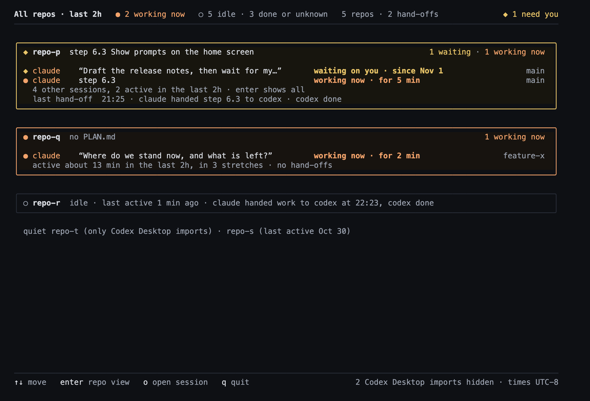
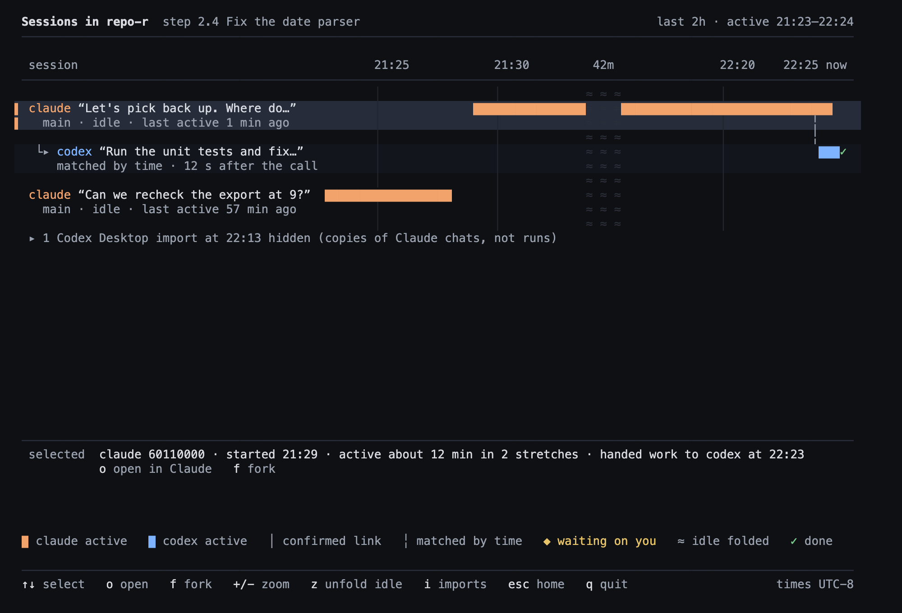
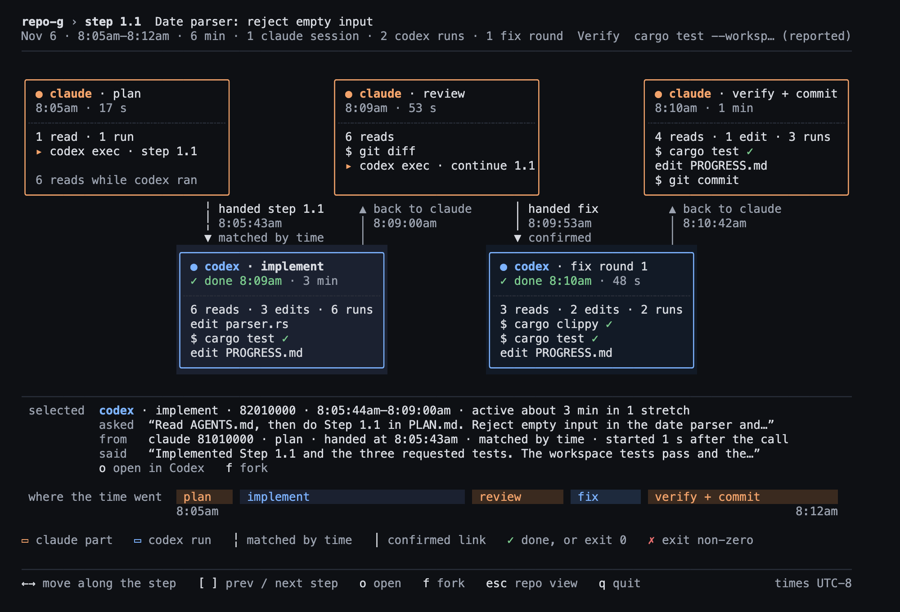
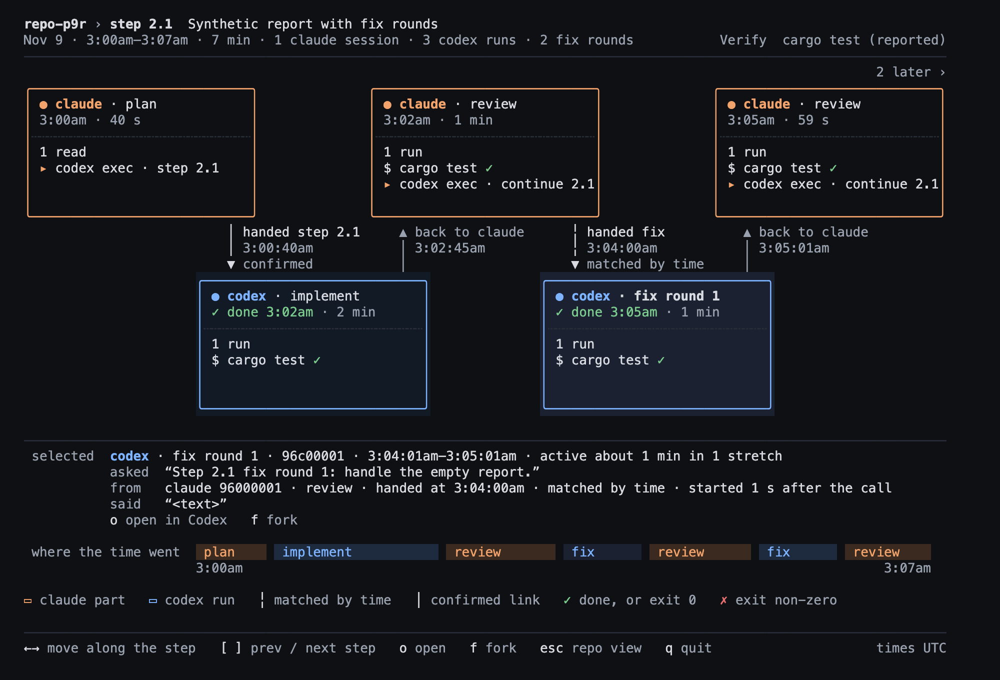
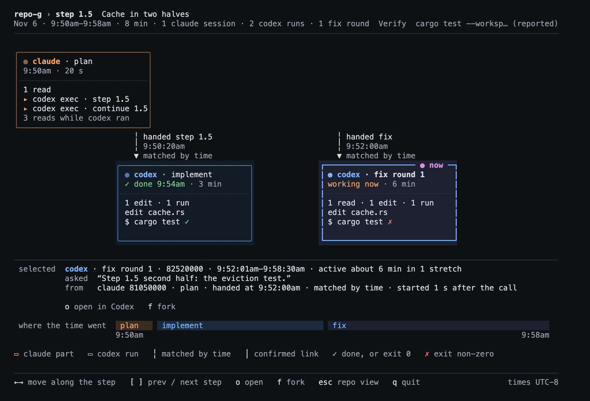
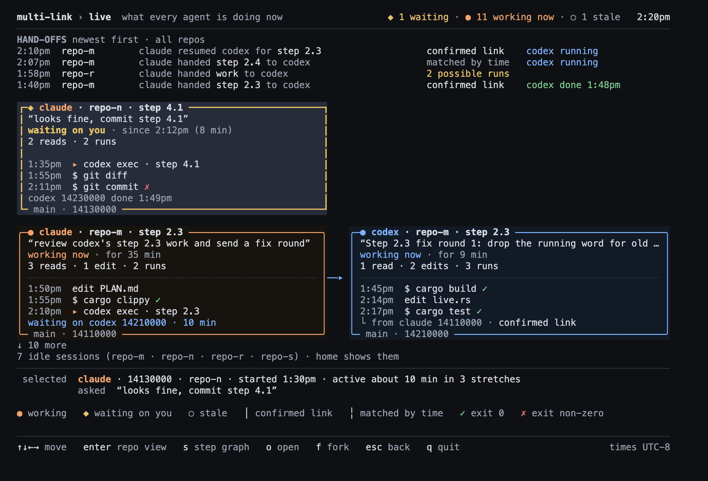
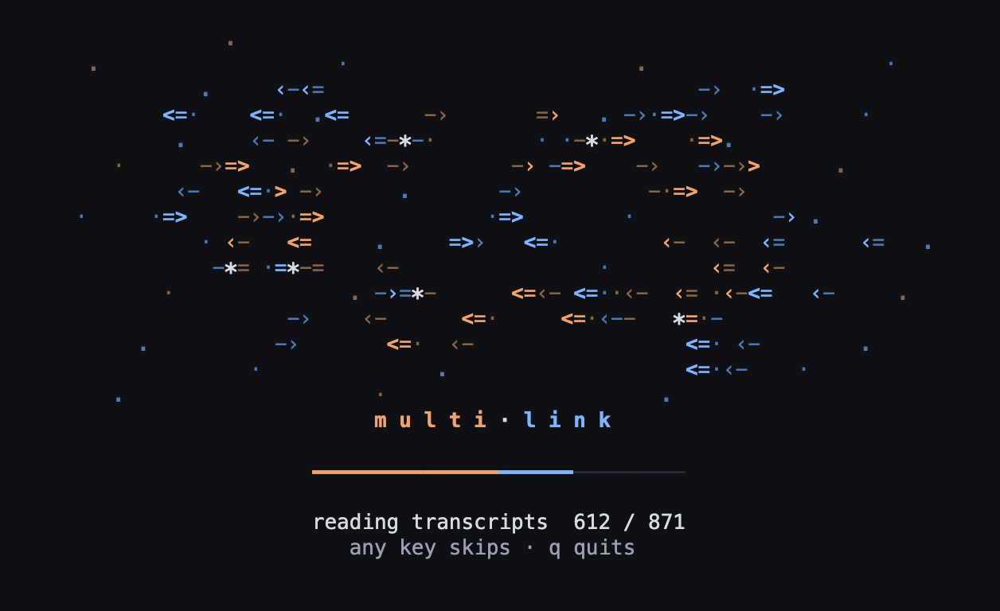

# multi-link reference

Everything the [README](../README.md) leaves out: each screen in detail, how states and links are decided, all keys and
commands, the full limitations list with its evidence, the release history and how releases are made. Install,
uninstall and hook setup are in [install.md](install.md).

## Contents

- [Release history](#release-history)
- [Home screen](#home-screen)
- [Repo view](#repo-view)
- [Step graph](#step-graph)
- [Live grid](#live-grid)
- [Loading screen](#loading-screen)
- [Claude Code pane (retired)](#claude-code-pane-retired)
- [Menu-bar app (macOS)](#menu-bar-app-macos)
- [States and links (Release 1.6)](#states-and-links-release-16)
- [Run](#run)
- [Limitations and validation](#limitations-and-validation)
- [Releasing](#releasing)

## Release history

Release 1 is complete (see [check results](phase3-check.md)). Release 1.1 (home screen
cleanup) did not meet the need ([owner verdict](phase4-check.md#owner-check-stop-and-ask)), and
neither did Release 1.2's bars ([owner verdict](phase5-check.md#owner-check-stop-and-ask--answered-2026-11-01)).
Release 1.3 rebuilt home in plain words and the repo view as swimlanes, to two approved mockups; the
owner approved the real screen ([visual check](phase6-check.md)). Release 1.4 polishes those screens
on real data (prompts after a system reminder, window words, clock times, axis labels); the owner approved it
([real check](phase7-check.md)). Release 1.5 adds the step graph: one PLAN.md step's Claude and Codex parts
along time; the owner approved it ([real check](phase8-check.md)). Release 1.6 makes states and links truthful:
ended Claude sessions say `finished`, compressed Codex rollouts are read, and more hand-offs find their run; the owner
confirmed it on real data ([real check](phase9-check.md)). Release 1.7 replaces hand-merging hook JSON with
`multi-link hook check`, which reports your hooks and prints one command that updates them ([hook setup](install.md#hook-setup)).
Release 1.11 adds the [live grid](#live-grid): what every working, waiting or stale agent is doing now, on one screen.
Release 1.12 makes the first load fast (the first home frame came up in 1.82–1.99 s on real data, down from about 9 s)
and shows a [loading screen](#loading-screen) while it runs. Release 1.18 makes the [menu-bar app](#menu-bar-app-macos)
one download with a setup window and an icon ([install](install.md)). Release 1.19 adds a release pipeline: every push
to `main` is tested on GitHub's macOS runner, a tag builds a draft release, and publishing it updates a Homebrew tap, so
the app installs with `brew` and the CLI can be used from Terminal ([install](install.md), [releasing](#releasing)).
Release 1.20 fixes two setup bugs: the setup window no longer keeps a stale "Notifications are not allowed" line under
a green row, and hooks owned by another copy of multi-link are reported as `other copy` (exit 0, no fix command)
instead of `outdated`; only `--take-over` or the app's **Turn on** moves them ([hook setup](install.md#hook-setup),
[check](phase24-check.md)).

What the releases add up to:

- Groups sessions by repo, with needs-you sorting, states and PLAN.md / PROGRESS.md status.
- Links Claude hand-offs to Codex sessions, marking exact, heuristic and ambiguous matches.
- Shows when each session was active in a per-repo swimlane view, with Codex runs nested under the
  Claude session that started them.
- Opens supported Claude desktop sessions or resumes sessions confirmed finished; rechecks the
  action before executing. Unsupported actions show a command for you to run.
- Draws one PLAN.md step as boxes along time: who planned, implemented, reviewed and fixed, in order.
- Shows every live session at once as a card: its state, for how long, its last few calls and the run it handed to.
- Opens in about 2 s, with a school of fish and a real file counter while the first load runs.

## Home screen



Times use a 12-hour clock with lowercase `am`/`pm`, no leading zero or space (`9:05pm`, with seconds
`8:05:43am`).

*HTML render of the home buffer on the synthetic fixture `fixtures/sessions-phase6` at 120×40
(`crates/tui/examples/home_html.rs`; method, the approved mockup in words and real-data differences in
[docs/phase6-check.md](phase6-check.md)). Real renders are not committed because they show prompts.
The real terminal uses your own font.*

- **Top line:** working, stale, idle and done-or-unknown counts, repos and hand-offs, and on the right
  `◆ N need you` in yellow when a session is waiting. With nothing waiting and no hook records seen, it
  says `◆ needs-you partial: no hook records seen` instead of claiming zero.
- **A card for each repo with a waiting, working or stale session:** a rounded
  card (yellow when waiting, orange when working) titled with its latest PLAN.md step. Each such session is
  one line: harness, a label (its custom title, else its latest step, else its latest prompt in quotes, falling back to its first prompt, else `claude · no prompt`), a status
  phrase (`waiting on you · since 9:40pm`, `working now · for 5 min`, `stale since …`) and its place (`worktree <folder>` or the current main branch).
  App background preambles are skipped separately for each prompt candidate. A repo header adds
  `· latest hand-off step <id>` when the hand-off differs from the logged step.
  **Claude prompt:** the first user message that is not blank and does not start with `<`, after dropping
  any leading `<system-reminder>…</system-reminder>` blocks (what a session started by another session
  begins with), so the real text after them counts; an unclosed reminder or any other leading tag still
  skips the message. Codex uses its first user message (or, in `codex exec` rollouts, the first user input
  that is not AGENTS.md instructions or a tag). **Times** less than 24 h old are a clock time (`9:05pm`,
  even if that was yesterday: 11:53pm seen at 2:07pm the next day); older ones are a date (`Nov 1`); `last active` says `N min ago` within the
  hour. A grey line counts the other sessions, and the last line names the latest hand-off in words (`claude handed
  step 6.3 to codex · codex done`).
- **The window is named:** the header and the card's lines say `last 2h`, or the `--since` window
  (`last 16h`).
- **Idle repos are one sentence:** `idle · last active 1 min ago · claude handed work to codex at 10:23pm,
  codex done`. Repos with no activity in the window share one `quiet` line.
- **Codex Desktop imports are hidden** (they are Claude chats copied into Codex Desktop, not runs); the
  footer counts them.
- **Colour** uses truecolor when `COLORTERM` is `truecolor`/`24bit`, else 256 colours; `NO_COLOR` keeps
  every glyph and word. Below 80 columns the branch drops first, then labels shorten on a word boundary.

## Repo view



*Same fixture, repo `repo-r`, its newest lane selected.*

- **Enter** (or `t`) on a home repo opens it. One lane per session with activity in the window, newest
  first; each Codex run sits under the Claude session that handed it work (`└▸`).
- **Bars are recorded activity:** timestamps at most 5 minutes apart form one burst. Claude bursts are
  orange, Codex blue; `✓` marks a finished Codex run, `◆` a session waiting on you.
- **Now line:** a magenta `┃` runs down the lanes at the current time, with `▼` and the `now` label on the axis.
  Bars, `✓` and `◆` draw over it, so a session that is working now visibly reaches it; grid and link lines give
  way to it. Magenta means now and nothing else, in both views. Panned into the past, the line is not drawn.
- **Links:** a line from the hand-off point to the child, solid `│` when confirmed, dashed `╎` when matched
  by time, and the sub line says how (`matched by time · 12 s after the call`).
- **The axis fits the work:** it starts at the first activity; idle stretches over 15 minutes with no
  activity on any lane fold to a `≈` band (at most 3), labelled with its length when there is room
  among the fold labels. The `now` label is placed first (`10:25pm now`, or `now` when space is short), so a fold
  never hides it; fold lengths then win over the end clock and ticks, and a tick never repeats the end or `now`
  minute. `z` unfolds,
  `+`/`-` zoom, ←/→ pan, `0` returns to the fitted range, `i` shows hidden imports.
- The `selected` line gives the session's short id, start, how long it was active and its hand-off; `o`
  opens it and `f` forks it. Below 80 columns the bars drop and the lanes become a list.

## Step graph



*HTML render of the step graph on the synthetic fixture `fixtures/sessions-phase8`, step 1.1, at 120×40 (method,
the approved board 9 in words and real-data differences in [docs/phase8-check.md](phase8-check.md)).*



*Synthetic fixture `fixtures/sessions-phase9`, step 2.1: one Codex run resumed twice with `codex exec resume --last`
shows as implement, fix round 1 and fix round 2, with a Claude review between them
([docs/phase9-check.md](phase9-check.md)).*



*Synthetic fixture, step 1.5, while its fix round is still running ([docs/phase11-check.md](phase11-check.md)).*

- **Live parts:** the part working now gets a heavy border in its colour and a magenta `● now` badge; while
  something is live, finished parts' borders and dots recede (their text keeps its colour). A Codex part is live
  while its run is `working` and it is that run's newest window; a Claude part is live when it is its session's
  newest part, the session is working and it was active in the last 5 minutes. A live part scrolled off screen
  shows `● now · N later ›` (or `‹ N earlier · ● now`); below 120 columns the list marks it `● now`.

- **`s`** on a repo-view lane opens that lane's latest tagged step. A coordinator lane with no hand-off of its own
  lists the steps of the sessions it started; a lane with neither says `no step on this session`. `←→` moves along
  the parts (`↑↓` below 120 columns), `[ ]` goes to the previous or next step with tagged hand-offs, `o`/`f` open or
  fork the selected part's session, `esc` returns to the repo view. The same report is on the CLI:
  `multi-link graph --repo "$PWD" --step 6.7 [--json]`.
- **Which sessions belong to a step:** only hand-offs whose prompt names the step (`Step 6.7`), their Claude parents
  and their Codex children. Steps are never guessed from time or files, so a step whose hand-off prompt did not name
  it, or a Claude-only step, has no graph.
- **Parts:** Claude boxes on top, Codex runs below, cut at hand-offs (the only events both harnesses record). Each box
  shows its start and length, `N reads · N edits · N runs`, and up to 3 notable calls with fixed labels (`$ cargo
  test`, `$ git commit`, `edit <file>` …). Edges say how each run was linked; the panel shows the selected part's
  prompt, its hand-off and the run's last message; the bottom strip shows each part's share of the step's time.
- **Part names are a reading by position, not evidence** (G3): the first Codex run is `implement`, every later run in
  the chain is `fix round N`, a Claude part followed by another hand-off is `review`, and the last is `verify +
  commit` only if it holds a `git commit`. A later run is not always a fix: Step 8.4's graph names every Codex run
  after the first `fix round 1` … `fix round 24`, though they come from 28 calls of 7 test halves, 7 code halves
  and 14 review fix calls (the first went through a wrapper script, are untagged and are not drawn).
- **Counts and marks** (G5, G6): shell commands that write files count as runs, not edits, because telling a write from
  shell text would be a guess, so boxes show fewer edits than happened. Labels are fixed by category, and no other
  command text is shown. `✓`/`✗` mean the call exited 0 / non-zero, not "tests passed" (a pipe to `grep` hides a
  failure). `✓` is drawn only on `$ cargo …`, `$ pytest` and `$ npm test`; any call that exited non-zero gets `✗`; a
  cargo, pytest or npm line with no mark has no recorded exit code. The header's Verify is the PLAN.md command, marked
  `(reported)`, never passed or failed.
- **Missing Codex runs:** an unlinked hand-off shows a dim `no codex run found` box, no return arrow, and `(the
  rollout may be gone)` in the panel. That wording is still wrong for some: Phase 9's rules (compressed rollouts,
  redirect logs, `resume --last`, below) cut real unlinked hand-offs from 124 of 222 to 47 of 221 on 2026-11-08, but
  at least 3 of the 47 (`cd` then `resume --last`) have their run on disk ([counts](phase9-check.md#links)).
  While a run is unlinked, the Claude part around it usually covers the time Codex worked, unless an earlier Codex run
  is still open (step 6.6).

## Live grid



*HTML render of the live grid on the synthetic fixture report `fixtures/expected/phase14/live.json` at 120×40
(`home_html --live-grid`; real check in [docs/phase14-check.md](phase14-check.md)). Real renders are not committed
because they show prompts.*

What is each agent doing right now, without switching terminal tabs? Press **`l`** on home or in a repo view, or start
with `multi-link tui --live`.

- **One card per session that is working, waiting on you or stale**, both harnesses, all repos, within the TUI's
  window. Idle sessions are one line (`7 idle sessions (repo-m · repo-n) · home shows them`); home still lists them.
- **Rows pair a Claude card with the Codex runs it started** (`──▸`; more children stack below with `└──▸`). A Codex
  card's parent is the Claude session of its latest confirmed or time-matched link. Waiting rows come first (longest
  wait first), then working, then stale.
- **Each card** says what it was asked (its latest prompt), its state and for how long (`waiting on you · since
  2:12pm (8 min)`, `working now · for 35 min`), its counts (`3 reads · 1 edit · 2 runs`), its last 3 notable calls with
  fixed labels and `✓`/`✗` marks (as the step graph), and its link: `waiting on codex <id> · 10 min`, `codex <id> done
  1:49pm`, or `└ from claude <id> · confirmed link`. The title adds `· step <id>` from its tagged hand-offs; the bottom
  border gives its place and short id.
- **The feed** on top lists the last 4 hand-offs in the window, all repos, with how each was linked and whether Codex
  is `running` or `done`.
- **Keys:** `↑↓` move between rows, `←→` along a row (both move card by card below 120 columns), `enter` opens the
  card's repo view, `s` its step graph, `o`/`f` open or fork its session, `esc` goes back to the screen that opened the
  grid (home for `--live`), `q` quits. The selection follows the same session across refreshes.
- **Sizes:** below 120 columns cards stack in one column, a Codex card under its parent (`└▸`); below 40 rows the feed
  shrinks, then goes; cards that do not fit leave `↓ N more` and the view scrolls with the selection.
- The same report is on the CLI: `multi-link live [--json]`.

## Loading screen



*HTML render of the loading screen at 76×22 with the fixture counter (`home_html --loading 4.0`; real check in
[docs/phase15-check.md](phase15-check.md)).*

The first load reads every transcript once; later refreshes reuse what is cached. Release 1.12 parses those files on
every core, so the cold `multi-link overview --json` went from 7.99 s to 1.16 s (median of 3 runs on the owner's
machine, 1069 files), and the TUI's first home frame came up in 1.82–1.99 s (3 runs; 1.94–2.09 s with `--live`).

- **While it loads**, two schools of ASCII fish swim through each other: the Claude-orange school circles, the
  Codex-blue school swims a figure-eight; where they meet, a pale `*`. Below them: the title, a progress bar and a
  counter of real work, `reading transcripts  612 / 871`, then `linking sessions…`, then `ready ✓  opening home`. The
  counter is files parsed out of files listed, never a timer.
- **It stays at least 1 second** (so it never flashes), then fades out over 250 ms into home.
- **Any key skips it**: to the plain `loading sessions…` footer if the data is not ready yet, otherwise straight home.
  `q` and Ctrl-C quit at any point and restore the terminal.
- **Sizes:** the fish need 60×16 or more; from 30×6 up to that only the counter and hint show; below 30×6 just the
  counter line.
- Uses only the existing theme colours; 256-colour terminals get their 256-colour values, and `NO_COLOR` keeps the
  glyphs with no colour, bold, dim or fade. A refresh error ends it at once with the error footer.


## Claude Code pane (retired)

Releases 1.13–1.15 shipped a Claude Code mod that showed a repo's sessions in a pane beside the chat; Release 1.17 removed it and the `multi-link pane` command, because the [menu-bar app](#menu-bar-app-macos) shows the same rows for every repo and sends the Codex-done notifications itself (old checks: `docs/phase16-check.md` to `docs/phase18-check.md`).

## Menu-bar app (macOS)

A small SwiftUI app (Release 1.16, `apps/menubar/`) puts multi-link in the macOS menu bar, so you can see every repo's
sessions without a terminal or a Claude Code window (board 19: P2, I1). The icon reads `ml` plus the number of Claude
sessions waiting on you, or `ml ○` when nothing is running. Its popover has one block per repo, in the home screen's
order, headed by its current step, with the repo view's rows and their Codex hand-offs under them. Clicking a row opens it
in the app or jumps to its terminal tab (`multi-link open --no-resume`); a Codex row copies its id. The footer has
`Open TUI` and `Quit`. While it runs and is allowed to notify, the app sends the `codex finished (<step>)`
notifications under its own name. Only one copy runs at a time (a lock file, `~/.multi-link/menubar.lock`); a second
one says `multi-link is already running` and quits.


Release 1.18 ships it as one download with the CLI inside and a setup window ([install](install.md)). To build it yourself, see [Build from source](install.md#build-from-source).

- It runs the CLI bundled inside it (`Contents/MacOS/multi-link`), so the app and its CLI are always the same
  version. Only if that is missing does it look in `~/.cargo/bin`, `/opt/homebrew/bin` and `/usr/local/bin`, or a
  path saved with `defaults write dev.multi-link.menubar multiLinkBinary <path>`.
- The setup window (first launch, or `Setup…` in the popover) turns on the Claude hooks and asks for notifications;
  if the hooks call another copy of multi-link, the Hooks row is amber ("Hooks use another copy: <path>") and Turn on
  moves them to this app (`hook apply --take-over`, Release 1.20). **Open at login** in the popover starts it at login. macOS asks once to let it control Terminal, on the first jump.
- `apps/menubar/release.sh` builds the app and packs it into `apps/menubar/build/multi-link-<version>-arm64.dmg`.
- The app is signed ad hoc, never notarized. Its signature names the bundle id, so a new version keeps the
  notification permission (Gatekeeper still asks for Open Anyway once per version).
- On a MacBook with a notch and a full menu bar, macOS hides new items behind the notch. If `ml` doesn't appear, remove
  or ⌘-drag away a menu-bar icon or two.

## States and links (Release 1.6)

Each rule below reads a format that Claude Code or Codex does not document; only the `SessionEnd` hook event is
documented. Each is designed so that a missing marker falls back to `unknown` or unlinked; a format that changes in
another way (say, `cost-state` written mid-session) could still give wrong results. Real counts before and after are
in [docs/phase9-check.md](phase9-check.md).

- **`finished` and its evidence.** A Claude session is `finished` only on positive evidence, checked in this order:
  its live session record (`~/.claude/sessions/<pid>.json`) means it is running and wins; `process_exit` (the record
  outlived its process); `session_end` (the hook's `SessionEnd` record, dropped when a later turn or hook record shows
  the session was resumed); `transcript_exit` (no live record, and the transcript's last `cost-state` record comes
  after its last turn; Claude Code writes it on every clean exit seen so far). This moved real Claude sessions from
  232 `unknown` / 0 `finished` to 3 / 229 (2026-11-08). Codex `done` still means only that the last turn completed.
- **Reopening a session finished by `transcript_exit` or `session_end`** depends on where it ran (the transcript's
  last `entrypoint`): `cli` or `sdk-cli` → `claude --resume <id>` in its folder; `claude-desktop` → the app link, only
  when exactly one desktop app record maps the session; anything else → Unavailable with the command shown, so a
  cleanly exited desktop session is not resumed in a terminal while the app may reopen it. A `process_exit` session
  still resumes in a terminal whatever its entrypoint (0 real cases on 2026-11-08).
- **Jumping to a running terminal session (Release 1.15).** `multi-link open` on a Claude session that is still
  running in a terminal brings its own tab to the front, instead of printing a `claude --resume` that would start a
  second copy. Its session record gives the process; one `ps` snapshot checks that the process is the same one (start
  time) and walks its parents to the terminal app; AppleScript selects the Terminal.app or iTerm2 tab whose tty
  matches. Nothing extra is installed. When it cannot jump it says why and exits 3, never resuming:

  | Answer | When |
  |---|---|
  | `jumped to Terminal · window W · tab T (ttysNNN)` | the tab was found and selected |
  | `inside_multiplexer (tmux)` | the session runs in tmux, screen or zellij |
  | `terminal_not_supported (Ghostty)` | another terminal app (named when known) |
  | `no_tty` | the process has no terminal |
  | `process_changed` / `ambiguous_process` | the record's process is gone or replaced, or several records match |
  | `cannot jump: its tab is gone` | the process runs but no tab has its tty |
  | `cannot jump: blocked by macOS…` | macOS Automation permission was denied |

  The first jump makes macOS ask to let the caller (your terminal, or the menu-bar app) control Terminal. If
  it was denied, allow it in System Settings → Privacy & Security → Automation. `--app-only` refuses a jump;
  `--no-resume` (what the menu-bar app uses) allows it. Codex sessions and tmux / Herdr panes are not jumped to.
- **Compressed rollouts.** Older Codex rollouts are on disk as `rollout-*.jsonl.zst` (a standard zstd frame holding
  the same JSONL). multi-link decompresses them in pure Rust (`ruzstd`), up to 64 MiB each; a file over the cap or
  that fails to decode is counted as unreadable, never an error. When the same run exists in both forms, the plain
  file wins. On 2026-11-08 this added 202 Codex sessions (223 → 425).
- **Redirect rule.** When a `codex exec` hand-off sends stdout to a file (`> log 2>&1`, `>>`, `1>`, `&>`, `&>>`,
  `>|`), the hook and the scanner read that file for Codex's `session id:` line. The link is `exact` (`redirect_file`)
  only when the file holds exactly one such line. Path limits: the target must be a literal path (no `$VAR` or quoted
  expansion), the segment must have exactly one stdout redirect, and a relative path counts only when no `cd` or
  subshell comes before the launch. The opened file must be a regular file (not a FIFO or device), have a single link
  and resolve under the hand-off's folder or the system temp folder (`$TMPDIR`, `/tmp`, `/private/tmp`). At most 64
  KiB is read, and an append log (`>>`, `&>>`) over 64 KiB is refused. Pipes to `tail` or `head` are not recoverable.
  Old logs are mostly gone, so the gain grows as the hook records new hand-offs.
- **`resume --last` linking.** `codex exec resume --last` names no session id. As seen so far (undocumented), it
  writes no new rollout and adds a turn to the run it resumes. multi-link links it to a run in the same checkout whose
  later turn (not its first) starts 0–10 s after the hand-off: `heuristic` with evidence `resume_turn`, or ambiguous
  when two runs qualify. An observed id (stdout or a redirect log) still wins and makes it exact. The 10 s window was
  not calibrated in advance; on real data all 13 such hand-offs had their turn 0.8–2.7 s later (before Phase 13).
  Only `codex exec resume --last` is matched this way; interactive `codex resume` needs an explicit id. Options
  before the id (`codex exec resume -c k=v <id>`, `--skip-git-repo-check`, …) are read when multi-link knows them;
  an unknown option leaves the id unread.
- **Launch folder.** A literal `cd` before the launch (`cd /abs/path && codex exec …`, also `./` and `../` paths)
  names the folder the run starts in, and the link records it as `launch_dir` when it differs from the session's
  folder. It is read only when it is certain: `$VAR`, `~`, plain names, `pushd`/`popd`, a `cd` joined with `||`, `|`
  or `&`, a wrapper (`builtin cd`), or `eval`/`source`/`exec` after the `cd` leave the folder unknown, and the hand-off
  stays unlinked. A `cd` joined with `;` is assumed to succeed. On 2026-11-10 the Phase 13 rules linked 34 real launch
  and 3 resume hand-offs that were unlinked ([details](phase13-check.md)).
- **Nearest run.** A launch hand-off with several Codex runs in its window gets the nearest one when the evidence is
  clear (rules above under Limitations); the link says `matched by time · nearest run`. On 2026-11-10 this settled 8
  of the 9 ambiguous real hand-offs ([details](phase12-check.md)).
- **Session folder (R8).** The first folder a Claude session's own records name is its home folder (records inherited
  from a resumed session do not set it). After that, a record's folder counts only if it is the home folder or inside
  it, so a shell `cd` elsewhere (Claude Code stamps later records with it) is ignored and the session stays in its
  repo; the session shows the newest folder that counts, such as a worktree.

Scanning only reads local agent files (`~/.claude`, `~/.codex`), repo metadata and optional
hook state in `~/.multi-link`. It makes no network calls. Opening a session launches the
corresponding external program; hook recording writes multi-link's own state directory.

## Run

`multi-link --version` (or `-V`) prints the installed CLI version.

Use ↑/↓ to select, Enter (or `t`) to open a repo view, `o` to open (or jump to a running session's terminal tab,
without leaving the TUI), `f` to fork, Esc to return, and
`q` to quit. In the repo view, `+`/`-` zoom, ←/→ pan, `0` resets the range, `z` unfolds idle stretches
and `i` shows imports; `s` opens the step graph for the selected lane. `l` opens the live grid from home or a repo
view (`multi-link tui --live` starts on it); `esc` returns. The default history window is `2h`; use
`--since all` for all history.

The CLI also exposes the data and safe open previews:

```sh
multi-link overview --json
multi-link sessions --json
multi-link links --json
multi-link steps --repo "$PWD" --json
multi-link graph --repo "$PWD" --step 6.7 --json
multi-link live --json
multi-link open <session-id-prefix> --dry-run
```

For fixture data, add `--root fixtures/sessions --now 2026-10-29T23:15:00Z --since all`
to `tui` or the report commands. `--root` enables fixture mode and disables real process probing.
Hooks are set up with `hook check` ([install.md](install.md#hook-setup)). See the [design](design.md) for hook behavior and
state rules.

## Limitations and validation

- The menu-bar app (Releases 1.16–1.17) was checked on this Mac (`docs/phase19-check.md`, `docs/phase20-check.md`):
  the popover matches board 19, and a real Codex hand-off showed a banner credited to multi-link. It did so only after
  System Settings → Notifications → multi-link → **Allow Notifications** was turned on; before that, macOS dropped two
  banners without an error and the app still counted them as announced, so those hand-offs were never shown. Pressing
  rows and Open TUI in the shipped app, the single-instance guard and the one-line header are covered by tests only.
  A Codex run that finishes after it and its Claude session were both quiet for 2 h is not announced. A completion in
  the first few seconds after the app starts notifying is not announced either.

- The terminal jump (Release 1.15) is macOS only and was checked live with Terminal.app from the CLI and the TUI
  (`docs/phase18-check.md`). **iTerm2 is untested** (not installed; covered by tests only), and so are tmux, other
  terminals, a real tab-gone process and a denied Automation prompt (fixtures and fake-runner tests). A session never
  sent a prompt has no transcript yet, so no list shows it. It relies on the session record's `pid`/`procStart`
  (undocumented). A running terminal session adds one `ps` per refresh (226 ms per refresh tick in the check).

- Claude Code and Codex transcript formats are undocumented and may change. Unknown records
  are skipped and counted; missing evidence can leave states or links unknown.
- Codex waiting detection and automatic Codex opening are unsupported.
- Claude desktop opening uses an undocumented `claude://` link.
- Resume and the app link require a transcript and positive exit evidence ([States and links](#states-and-links-release-16)). `transcript_exit`
  relies on the undocumented `cost-state` record; `session_end` needs the hook with `SessionEnd` (`multi-link hook check`
  reports it). On 2026-11-08, 72 finished desktop sessions had no single app record, so
  `o` shows Unavailable with the command for them.
- Links matched by time can be wrong. When several Codex runs start in one checkout within the 60 s window,
  multi-link picks the nearest run only when the evidence is clear: a run that another hand-off would itself pick at a
  smaller gap goes to that hand-off, and of the runs left the nearest is picked if it started within 5 s and every
  other run 10 s or more after the hand-off (`matched by time · nearest run`, never `confirmed`). These margins are
  provisional: on 2026-11-10, 30 hand-offs with an observed child gave 0 wrong answers with the id hidden, but few of
  them had rival runs. It assumes Codex starts a run within seconds of its launch, so a run that starts late can be
  given to a later hand-off. On 2026-11-10 no real hand-off stays ambiguous: the last one was settled once a `cd`
  linked its rival run to another hand-off ([details](phase12-check.md), [Phase 13](phase13-check.md)).
- `cd` resolution has no hidden-id test: only 1 real hand-off with an observed child used a `cd`, and its child started
  before the hand-off, so it stays unlinked with the id hidden. Each folder resolved on real data had exactly one run
  in the window.
- Activity is inferred from record timestamps: a tool call that writes nothing for over 5 minutes
  shows as a gap, and screens say "active", never "worked".
- Codex "done" means its last turn completed; there is no process-exit evidence.
- Some sessions still show `no prompt`. On 2026-11-02 (PST): 11 of 185 Claude sessions (in the Phase 7
  plan's count these were other wrappers such as `local-command-caveat`, `bash-input`, `scheduled-task`, a
  reminder with nothing after it, or no eligible record) and 3 older non-imported Codex runs
  ([counts](phase7-check.md#real-prompt-count-p1)).
- JSON output now includes prompt text: `sessions` and `overview` carry each session's first prompt
  (`asked`, up to 120 characters). Check before sharing JSON.
- macOS only for now.
- Mac app download limits (Release 1.18). The app is **not notarized** (no Apple Developer account), so macOS blocks
  the first open of every downloaded copy and every new version until you click Open Anyway in Privacy & Security
  with your Mac's password; a managed Mac may not allow that. multi-link never removes the quarantine flag or works
  around Gatekeeper. The DMG is **Apple silicon (arm64) only**, macOS 15 or later. The app counts itself as "running
  from the download" only under `/Volumes/` or an `AppTranslocation` folder; a DMG mounted by hand elsewhere
  (`hdiutil -mountpoint`) is not caught, and setup would point the hooks at it (seen once in the
  [Phase 21 check](phase21-check.md)). The hooks call the app's bundled CLI by its full path: **if the app is
  deleted or moved without Remove hooks first**, every hook call fails until you run `multi-link hook remove` (or
  re-open the app from its new place and click Turn on). The real first-run check (Safari download, Open Anyway, the
  setup rows on real clicks, an upgrade, a login launch, a hand-off banner with the new icon) passed with the owner
  ([Phase 21 check](phase21-check.md)).
- Homebrew and release limits (Release 1.19). The cask is in multi-link's own tap, not Homebrew's official one, which
  takes only notarized apps. Homebrew quarantines the app like a download, so **Open Anyway is needed once after a
  fresh Homebrew install** too; until then the `multi-link` command is killed with no message (exit 137, seen in an
  isolated test). Homebrew refuses to install over a DMG copy in `/Applications` (move it to the Trash first; never
  `--force`). The **Use in Terminal** link only works if no earlier `PATH` entry has a `multi-link` (`command -v
  multi-link` shows which one runs). CI runs on one macOS arm64 runner only; the first release built by it, and the
  switch from a DMG install to Homebrew on a real Mac, are checked in [docs/phase22-check.md](phase22-check.md)
  (owner check passed 2026-11-17). The first real `brew upgrade` (1.19 → 1.20, 2026-11-17) kept the Open Anyway
  approval: no prompt, quarantine `03c1;…` on the new copy ([Phase 24 check](phase24-check.md)). One upgrade on one
  Mac only.
- Hook setup limits. The merged file is rewritten as 2-space JSON, so its whitespace and indentation may change
  (values, key order and your entries do not). To keep values exact, the check refuses (exit 2) a file with a
  duplicate key or with a number serde_json would not write back as the same text: beyond 64-bit integers, and also
  forms like `1e5` or `1.50`. An edit to the settings file in the milliseconds between `--merged` reading it and the
  final `mv` is lost; there is no lock that Claude Code also honours. `hook apply` (and the setup window) re-reads the
  file just before its rename and refuses a changed file, which narrows that window to the moment between that
  re-read and the rename; an edit landing exactly there is still lost. "Current" means current in that one file: it
  does not read other settings levels (project, local, managed policy), so it cannot prove they let the hooks run.
  The binary path is compared as text, not checked to exist.
- Step graph limits: Step 8.4's own graph is misnamed (24 runs as fix rounds) and 10 of its 25 runs are unlinked.
  Nesting sessions under the session that started them (repo view, and `s` on a coordinator lane) relies on the
  Claude desktop app's undocumented per-session records. The first refresh after start takes about 6.4 s on the
  owner's machine (the overview's first full parse, older than the graph); later refreshes with the largest real
  graph open took 229–236 ms (Step 8.5). Pressing `[ ]` quickly builds every graph it passes (about 230 ms each). The repo view's footer
  drops `q quit` at 101–109 columns. With a graph open each refresh runs the all-time pass twice. The narrow list
  form (below 120 columns) and the 256-colour palette are tested on fixtures only, not checked on real data.
- Live grid limits. Card calls use the step graph's fixed labels, so plain reads and any command without a label
  (most of what an agent does between edits) never show on a card; a card can look quieter than its session was.
  Codex part kinds (`implement`, `fix round N`) are not shown: they need the step's chain, which only the step graph
  builds for tagged hand-offs. A stale Codex run last active before the window is history, not a card. Codex cards
  are never `waiting` (Codex waiting is unsupported, above). On 2026-11-10 the real check saw only 1–2 working Claude
  cards, no Codex card and nothing waiting or stale, so pairing, waiting and stale cards are tested on the fixture
  only. With the grid open, later refreshes took 187–248 ms on real data; the first refresh after start took 9.2 s,
  of which the grid was 102 ms and the rest the overview's first full parse ([timing](phase14-check.md)).
  Release 1.12 cut that first refresh to 1.58–1.63 s with the grid ([timing](phase15-check.md)).
- Loading screen limits. Its 256-colour and `NO_COLOR` forms and the fade's colour steps are tested against
  answer keys only; the real check ran in a truecolor PTY and read text, not colours. The first-load times above are
  from one machine (14 cores) with other sessions running; on a busy machine one `--live` first report took 2.2 s,
  over the 2 s target ([timing](phase15-check.md)).

Workspace tests and clippy passed in the Step 3.8, 4.6, 5.5, 6.5, 7.4, 8.6 and 9.7 runs. Real-home
timing output, terminal evidence and validation limits are in [docs/phase3-check.md](phase3-check.md);
the Phase 4 home check is in [docs/phase4-check.md](phase4-check.md), the Phase 5 visual check in
[docs/phase5-check.md](phase5-check.md), the Phase 6 visual check in
[docs/phase6-check.md](phase6-check.md), the Phase 7 real check in
[docs/phase7-check.md](phase7-check.md), the Phase 8 real check in
[docs/phase8-check.md](phase8-check.md) and the Phase 9 real check in [docs/phase9-check.md](phase9-check.md).

## Releasing

For the maintainer. Releases are built by GitHub Actions, never by hand.

1. Set the new version in `apps/menubar/Info.plist` (both `CFBundleShortVersionString` and `CFBundleVersion`) and
   `[workspace.package]` `version` in the root `Cargo.toml` (`1.21` in the plist → `1.21.0` in Cargo). The
   `plist_version_matches_cargo` test fails CI if either plist key differs from Cargo. Commit, push `main` and wait
   for the [CI workflow](../.github/workflows/ci.yml) to pass.
2. Tag that commit and push the tag: `git tag v1.20 && git push origin v1.20` (with the new version). The
   [release workflow](../.github/workflows/release.yml) refuses a tag that doesn't equal `v` + the plist version or whose
   commit is not on `main`, runs the CI job on it, builds the DMG with `apps/menubar/release.sh`, and opens a **draft**
   release with exactly two files: `multi-link-<version>-arm64.dmg` and its `.sha256`.
3. Check the draft on the releases page (the two files and their sizes), then click **Publish release**.
4. Publishing runs the [cask workflow](../.github/workflows/cask.yml), which checks the two files and their checksum and
   pushes `Casks/multi-link.rb` at the new version to [`jar-narvz/homebrew-tap`](https://github.com/jar-narvz/homebrew-tap)
   (it needs the `TAP_TOKEN` repository secret; it refuses prereleases and versions not newer than the tap's).

To rebuild a draft, delete it first: the release workflow fails if the tag already has a release.
